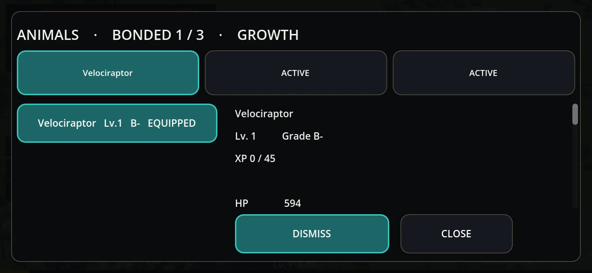
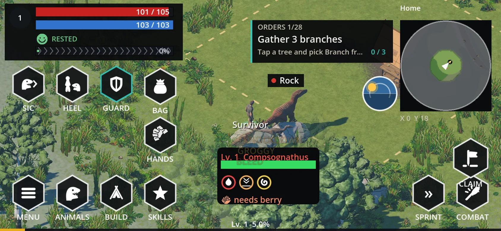
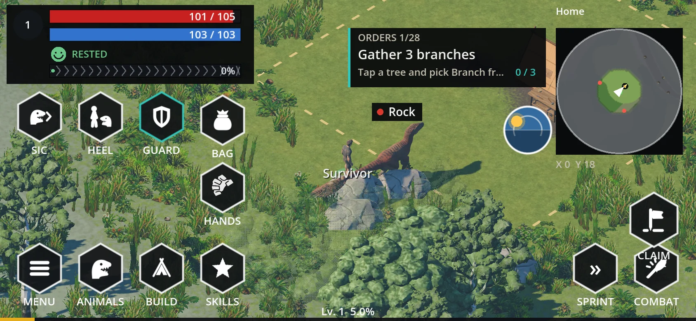

# Creatures, AI, capture & taming — as the build runs today

Species data: `game/data/creatures/*.json`, one file per species, fields per
`game/data/creatures/SCHEMA.md`, read by `game/scripts/creatures/creature_def.gd`. AI tuning:
`game/data/creatures/ai.json`. Brain: `game/scripts/creatures/brains/creature_brain.gd` (BODY
`game/scripts/creatures/creature.gd`). Spawns: `game/scripts/world/island_spawns.gd` +
`game/scripts/world/spawner.gd`. Capture: `game/scripts/pets/capture_system.gd`, field tame:
`game/scripts/pets/field_tame.gd`, hunt actions: `game/scripts/combat/hunt.gd`, pen:
`game/scripts/world/taming_pen.gd`, pet record: `game/scripts/pets/pet_record.gd`, pet stats:
`game/scripts/pets/pet_stats.gd`, summons/riding: `game/scripts/player/player_pets.gd`.

## Species roster (19 JSONs)
Each species carries `tier` (its own level), `archetype`, `tameable`, `capture_tier`, `stats{hp,
attack, defense, speed, bag_slots}`, `taming{preferred_food, accepted_food, feeds_needed,
window_seconds, requires_pen}` and `clips`.

| species | tier | archetype | tameable | capture_tier | hp | atk | def | speed | feeds | pen |
|---|---|---|---|---|---|---|---|---|---|---|
| zebraceratops | 13 | pack_mule | yes | 1 | 720 | 36 | 80 | 400 | 3 | no |
| compsognathus | 15 | swarm | yes | 1 | 90 | 7 | 10 | 650 | 3 | no |
| coelophysis | 18 | flock_harass | yes | 1 | 420 | 60 | 30 | 720 | 3 | no |
| protoceratops | 20 | pack_mule | yes | 1 | 980 | 45 | 110 | 420 | 3 | no |
| velociraptor | 25 | pack_raptor | yes | 2 | 640 | 95 | 40 | 700 | 3 | no |
| megaloceros | 30 | antlered | yes | 2 | 1800 | 150 | 80 | 760 | 3 | no |
| gallimimus | 30 | runner | yes | 3 | 1400 | 120 | 50 | 900 | 6 | yes |
| deinonychus | 35 | pack_flanker | yes | 3 | 1450 | 165 | 70 | 660 | 3 | no |
| dilophosaurus | 40 | venom_ranged | yes | 4 | 2600 | 210 | 80 | 560 | 6 | yes |
| smilodon | 45 | saber_cat | yes | 5 | 3800 | 360 | 140 | 720 | 3 | no |
| styracosaurus | 45 | horned_charger | yes | 3 | 5200 | 300 | 220 | 470 | 6 | yes |
| stegosaurus | 45 | spiked_tail | yes | 4 | 8500 | 380 | 300 | 400 | 6 | yes |
| allosaurus | 50 | apex_raptor | **no** | 0 | 9000 | 480 | 180 | 520 | 6 | yes |
| utahraptor | 50 | apex_raptor | yes | 5 | 4200 | 340 | 120 | 620 | 6 | yes |
| ankylosaurus | 50 | club_tail | yes | 4 | 12000 | 420 | 520 | 380 | 6 | yes |
| triceratops | 55 | horned_charger | yes | 5 | 14000 | 520 | 380 | 450 | 6 | yes |
| brachiosaurus | 60 | titan | **no** | 0 | 90000 | 900 | 500 | 300 | 6 | yes |
| tyrannosaurus | 60 | tyrant | yes | 0 | 200000 | 1100 | 400 | 450 | 6 | yes |
| tarbosaurus | 60 | tyrant | yes | 5 | 24000 | 700 | 260 | 480 | 6 | yes |

`capture_tier` 0 cannot be netted (no net of tier 0 exists). Absent `taming` defaults
(`creature_def.gd`): herbivores prefer berry / accept fibre_stalk, carnivores prefer raw_meat /
accept fish or raptor_meat; length > 5 m → 6 feeds and requires_pen, else 3 feeds and field
completion.

## Brains & AI (`ai.json`, `brains/`)
- States: roam, alert (0.6 s), approach, attack, retreat, flee, disengage, sleep, downed, dead;
  thinks at `THINK_HZ` = 10, staggered per creature.
- Archetypes (15 in `ai.json`, plus `default`): pack_raptor, pack_flanker, apex_raptor, swarm,
  flock_harass, venom_ranged, saber_cat, tyrant, pack_mule, spiked_tail, runner, antlered,
  club_tail, horned_charger, titan.
- Defaults: perception = 8.0 + tier × 0.15 m; attack_range 1.4–2.8 m by archetype; aggro leash =
  perception × `leash_mult` 1.5, never under `aggro_radius`'s 26.0 m when the target is a
  structure; disengage 3.0 s; retreat at
  `retreat_threshold_frac` 0.3 of max HP; flee 8.0 tiles; `chase_speed_mult` 0.7; sleep wake at
  3.0 m and stay awake 30.0 s; `weak_to` ×1.5, `resists` ×0.6 (slashing, blunt).
- Temperaments: skittish (flee on sight, provoke after 3 hits, ×1.6 flee speed), defensive
  (provoke after 1 hit, ×1.2), territorial (1 hit, ×1.2, inside `territory_m` 6.0).
- Specialised brains: `raptor_pack_brain.gd` (alpha + followers), `tyrant_brain.gd` (bite windup
  0.7 s, stomp 1.2 s, stagger after 3 blunt hits poisoned / 6 unpoisoned), `pet_brain.gd`
  (guard radius 9.0 m, drop target at 45.0 m, follow slots in `ai.json` `follow`),
  `tactical_brain.gd` (the class profiles below), `brain_flight.gd`, `brain_rest.gd`.
- Brain selection (`Creature._make_brain`, `game/scripts/creatures/creature.gd`): pet → `PetBrain`;
  tyrannosaurus → `TyrantBrain`; any other species whose archetype row has a `tactics` block →
  `TacticalBrain` (`TacticalBrain.has_tactics`); a `raptor_pack` archetype → `RaptorPackBrain`; else
  `CreatureBrain`. Today only `pack_flanker` (deinonychus) carries `tactics`.
- Tactical AI: a `TacticalBrain` animal closes to a stand-off ring (`ring_m` 5.5 for the deinonychus),
  strafes around it, and picks its strongest off-cooldown, affordable, in-range attack from
  `attack_priority` (deinonychus: combo, pounce, bite). Every move has its own cooldown in the
  archetype's `tactics` block; when nothing is ready it backs off with a backward leap (`hop`),
  strafes, flips direction or feints. The pounce telegraphs 0.8 s, leaps and hits for `pounce_mult`
  1.5×; the combo's three hits scale 1.0 / 1.3 / 1.8. Below `retreat_frac` 0.4 of max HP it retreats
  facing the prey, then circles wider. Its states (`circle`, `feint`, `lunge`, `pounce`, `combo`,
  `attack`, `retreat`, `approach`, `hop`) are full-rate thinking states. Natures scale it through the
  `tactic_*` knobs in `natures.json`. Code: `game/scripts/creatures/brains/tactical_brain.gd`, data:
  `game/data/creatures/ai.json` `archetypes.<archetype>.tactics`, test: `game/tests/t_tactical.gd`;
  the full profile is [enemy-ai-template.md](enemy-ai-template.md).

## Tactical AI by class ([enemy-ai-template.md](enemy-ai-template.md))
Driven by the archetype (`ai.json archetypes.<a>.tactics`), not by per-species code. Families from
`combat_counters.json archetype_family`. Only the rows marked **built** run today.
| Archetype (family) | Species | Tactics |
|---|---|---|
| pack_flanker (fast_hunter) | deinonychus | **built**: ambush from tree cover; sequences (backstep / powerful strafe → pounce, charge, leap-in combo); leap back; hold / strafe / feint fillers; rare basic bite |
| pack_raptor, apex_raptor (fast_hunter) | velociraptor; utahraptor, allosaurus | planned (owner suggestion): circle, flank, lunge, pounce; apex fewer feints, bigger pounce. Today: RaptorPackBrain |
| swarm, flock_harass (fast_hunter) | compsognathus; coelophysis | planned: hit-and-run darting. Today: CreatureBrain |
| saber_cat (fast_hunter) | smilodon | planned: stalk, then pounce from stand-off |
| tyrant, titan (giant) | T. rex, tarbosaurus; brachiosaurus | T. rex: TyrantBrain (telegraphed bite / stomp, no circling); the rest planned the same |
| horned_charger, antlered | triceratops, styracosaurus; megaloceros | planned: line up, long wind-up straight charge, staggered after a miss |
| club_tail, spiked_tail (armored) | ankylosaurus; stegosaurus | planned: turn side-on, tail swipe when you are beside or behind |
| venom_ranged (venom_hunter) | dilophosaurus | planned: keep distance and spit |
| pack_mule, runner | protoceratops, zebraceratops; gallimimus | planned: flee, kick when cornered |
A "berserker" is a nature (Aggressive: shorter cooldowns, more charges), not a class.

## Spawns
- `IslandSpawns.spawn_all` places fixed rows from the island def's `creatures[]` and ring-band
  rows from its `spawns{}`; ring radius bands come from `rules.json` `rings` (landing 0–30,
  gathering 30–90, working 90–160, crater 160–210, far_shore 210–240 m from ring_centre).
- Cap `rules.json` `creature_cap_mobile` = 24 creatures per island; spawn rng seed 41; a spot must
  be dry land and at least 25 m from camp and from the harbour (`IslandRuntime.spawn_ok`).
  `Spawner.spawn_now` builds the nodes; a `count>1` row becomes a pack.

## Capture, as the code does it now (`CaptureSystem.attempt`, `Hunt.use_net`)
1. `FieldTame.capture_window()` must be open: alive, `tameable`, not a pet, and either the `knockdown`
   status at any HP or HP fraction ≤ `FieldTame.CAPTURE_HEALTH_FRAC` = 0.30 (spec 09).
2. One hint per creature, "Stun the dinosaur to capture it safely.", when a hunted tameable animal
   is at ≤ 50 % HP and not stunned (`Hunt.STUN_HINT_FRAC`). DoTs skip an animal inside the window.
3. `Inventory.best_capture_net` must hold a net whose `capture_tier` ≥ the species'
   `capture_tier`; nets are `capture_net_i` … `capture_net_v` (tiers 1–5) in `game/data/items.json`.
4. The survivor needs the matching capture technique (`Data.has_capture_technique`).
5. Chance (`CaptureSystem.chance_for`), on the animal's actual HP:
   - with a survivor (the normal throw) it is the taming S-curve, `TamingOdds.odds_for` — see
     "Taming odds" below; `attempt` rolls exactly the number the plate shows;
   - with no survivor (labs, the server holding no skills) the older shape is kept:
     `TIER_BASE`[net tier] × (1.5 − HP fraction), clamped 0.05–0.90, `TIER_BASE` =
     1:0.35, 2:0.45, 3:0.55, 4:0.65, 5:0.75 (an assumption in code).
6. Success consumes 1 net and puts a `captured_animal` stack (species, variant, level, genetics,
   `slot_span` 4) into the bag. Failure clears capturability and applies `enraged`.

Nets do not damage. `Hunt.use_net` refuses with "Stun it or weaken it to 30% health to capture it."
Knockdown itself comes from tackle/kick/stagger — see `game/scripts/combat/combat_tactics.gd`.

## Taming odds (`TamingOdds`, `game/data/taming_odds.json`)

One logistic curve on `(Survival level − creature level)`, shifted by remaining health and by the net
tier, clamped to [0.05, 0.95]. Roadmap: `docs/design/durango-informed-improvements.md` 5.

- `level_z(gap)`: log-odds on each side of an even gap, with separate slopes so the doc's anchors hold —
  50 % at an even gap, 85 % ten levels ahead, 10 % ten levels behind (`level_odds(gap)`).
- `health_z(hp)`: `hp_logit_per_hp` × (0.30 − HP fraction), i.e. 0 at the capture threshold and higher
  as the animal weakens. The 0.30 is read from `FieldTame.CAPTURE_HEALTH_FRAC`, never re-defined here,
  so the anchors hold at exactly the threshold; the copy in the JSON is a sanity check the test
  compares.
- `tier_z(net_tier)`: `tier_logit_per_tier` per tier above I.
- `odds_for(target, player, net_tier)` is the whole thing; `odds_for_values(level, hp, survival, tier)`
  takes numbers; `raw_odds` skips the clamp; `succeeds(p, rng)` is the single roll (seeded when a
  `RandomNumberGenerator` is passed); `caption(p)` is the plate text, "Tame 64%".
- Shown == rolled: `FieldTame.plate_hint` puts the odds in `hint.odds` and the caption in `hint.text`,
  `CreaturePlates._tick_tame_hint` prints it (green at ≥ 50 %, amber below, with the feed progress
  while feeds are still owed), and `CaptureSystem.attempt` rolls `TamingOdds.succeeds(chance, rng)`.
- ASSUMPTION: the levels in the JSON besides the doc's three anchors (health slope 1.5, tier slope
  0.25, clamp band) are first-pass numbers, not balance. Balance is the owner's, after skills/building.
- The capture-open rule did not move: 0.30 opens, 0.31 stays closed, odds never open a 31 % animal.

## Field tame (`FieldTame`)
- `can_attempt`: alive, `tameable`, not a pet, no tame cooldown, inside `capture_window()`.
- `lock_reason`: `capture_tier` ≤ `FREE_CAPTURE_TIER` 1 is free; above it needs the technique.
- `apply_feed` takes 1 feed (1.2 s each) of preferred (worth 1.0) or accepted (0.5) food, extends
  the knockdown by 6.0 s, and sets the feed total. Refused at the bonded cap before the food is
  spent.
- Window = the species' `taming.window_seconds` (45 s); completion at `feeds_needed`.
  `requires_pen` species never complete in the field.
- Success (`_complete`) builds a `PetRecord` (origin `tame`, wild level carried), bonds it and
  summons it. Expiry (`fail`) releases the knockdown, applies `enraged`, 60.0 s cooldown.
- Grade by preparation: a `bait`-category item in the bag (`leech`) is spent on the completed tame and
  adds `bait_iv_bonus` (6) to every IV before the record is built, so
  `PetRecord.grade = genetics.overall_tier()` comes out higher (B → A for a neutral animal). No bait
  leaves the genetics alone; an unfinished tame (a `requires_pen` species fed in the field) keeps its
  bait. ASSUMPTION: the doc says the grade improves with preparation but not by how much, so this is
  bait yes / no only.

## Pen (`TamingPen`, building `makeshift_taming_pen`)
- `try_insert` takes one `captured_animal` from the bag; `BASE_SECONDS` = 30 min of real time,
  scaled by `Game.time_scale`. Each `feed` costs 1 raptor_meat and sets the remaining time to
  max(5 s, 60% of what is left).
- On finish: `SUCCESS_CHANCE` = 0.70 bonds the animal (origin `capture`); failure spawns it back
  wild and fleeing. At the bonded cap the finished animal stays in the pen unbonded.

## Natures (owner 2026-10-28)

A Pokémon-like temperament that changes BEHAVIOUR only, on top of the archetype and temperament
above (it never replaces them and never edits a species' stats). Table:
`game/data/creatures/natures.json`; helper: `game/scripts/creatures/brains/brain_natures.gd`
(`class_name CreatureNatures`); knobs are read in one place each, through
`Creature.nature_knob()/nature_flag()` (`game/scripts/creatures/creature.gd`).

| nature | what it does | knobs (default 1.0) |
|---|---|---|
| Timid | avoids combat, more likely to flee | `flee_threshold_mult` 1.6 / `retreat_threshold_mult` 1.8, `aggro_radius_mult` 0.9, `retreat_as_flee`; never on tyrant/titan |
| Brave | protects its rider even when wounded | `retreat_threshold_mult` 0.5, `protect_rider_below_hp` 1.0 (a ridden pet never stands down for its own HP) |
| Aggressive | attacks nearby threats without orders | `auto_engage` (engages unprovoked, also means a grazer does not flee on sight), `aggro_radius_mult` 1.3, `guard_radius_mult` 1.25; weight ×0.1 on grazer archetypes |
| Territorial | stays close and protects its owner | `follow_dist_mult` 0.7, `guard_radius_mult` 1.4, `protect_owner` (threat measured from the owner too) |
| Stubborn | harder to tame, resistant to fear | `feeds_mult` 1.5, `tame_window_mult` 0.75, `pen_time_mult` 1.4, `fear_immune`, `retreat_threshold_mult` 0.6 |
| Docile | easier to tame, less effective in combat | `feeds_mult` 0.33, `tame_window_mult` 1.25, `pen_time_mult` 0.8, `damage_dealt_mult` 0.75 |

- Roll: once per animal at spawn, seeded from species + spawn point + pack
  (`CreatureNatures.spawn_key`), weighted by `weights` and masked per archetype (`never`, `only`,
  `rare_for`). Docile and Timid are the common ones.
- AI: `creature_brain.gd` (`_effective_perception`, `_flees_on_sight`, `damage_threshold`,
  `retreat_fraction`, `note_damage`, `_spot`), `raptor_pack_brain.gd` (retreat line),
  `pet_brain.gd` (`guard_radius`, `_threat_distance`, `nature_keeps_fighting`,
  `follow_inner`/`follow_outer`/`slot_distance` for the follow band; `nature_stop_distance` is the
  old single-point reading of the same knob), damage dealt in `Creature.attack_for` for wild animals and in
  `PetRecord.stat_value` for pets (its one stat source, so a Docile pet hits softer while the
  stored `attack` the PETS sheet shows stays the species number).
- Taming: `Creature.feeds_needed()/tame_window_seconds()` = species number × nature;
  `FieldTame` (window, feeds, completion) and `TamingPen` (wait at insert, nature carried on the
  captured stack by `CaptureSystem`) read them. Spec 09's capture rule is unchanged.
- Name and tag (owner 2026-10-28: "put it as a tag under their name, not in the name itself"): the
  name is the animal's own — species, with the colour variant or "Alpha" (pack leader) in front:
  "Velociraptor", "Alpha Velociraptor". The nature is a small chip directly UNDER that name, its
  short label only ("Timid"), built by `game/scripts/ui/nature_chip.gd` (`NatureChip`, the spec §5
  trait chip in its gold/positive style) and fed by `CreatureNatures.tag_for()` / `tag()`. Shown on
  the world plate (inside the pill, between the name and the HP bar; the plate keeps its 176x94
  budget and the chip row is always reserved, so nothing jumps), on the Animals screen (each roster
  row, each ACTIVE slot and the detail header) and in the pet radial's centre disc. No nature, no
  chip and no gap; the name helpers (`CreatureNatures.display_name/display_title`) no longer take a
  nature at all, so a nature cannot creep back into a name.
- Saves: `PetRecord.nature` is an optional field. A pet row without one (an old save, the server's
  roster) loads with the nature its uid derives, and every later load agrees. Fixture:
  `game/tests/fixtures/pet_record_no_nature.json`; test: `game/tests/t_natures.gd`.
- Known gap for the integrator: `core/data.gd` still walks every `*.json` in `data/creatures/`
  as a species, so each boot logs `[data] FAIL … natures.json: creature json missing species`
  (a `push_error`, nothing gates on it); and the server's `_tame` uses the species feed count and
  mints pets without the wild nature (the store round-trips whatever it is given, and
  `PetRecord.from_dict` derives a nature, so nothing breaks).
- `# ASSUMPTION`: every number in the table is a first pass for measurability, not balance, and
  the pet rule "a pet below its retreat threshold drops the fight" is new; only a Brave pet with
  its owner riding keeps fighting.

## Energy (owner 2026-10-28)

Every creature, wild or pet, has an energy pool (`Creature.energy` / `energy_max`). It has no
exhaustion and no treadmill. Running and special moves spend it, and rest or a walk refills it.
Rules: `ai.json` `"energy"`. A species JSON may override them with an `"energy"` block
`{max, regen_per_s, run_drain_per_s, costs{clip: n}}`, or give a clip entry as an object with
`"energy_cost"`. Code: `game/scripts/creatures/creature.gd` (energy section). Test:
`game/tests/t_energy.gd`.

- Size default: pool = 80 + 6 × `real_length_m`, refill time = 10 + 0.5 × length s (bigger means a
  larger pool and a slower refill). Running drains 10/s.
- Hysteresis: at or under 5 % (`stop_frac`) the animal is `winded`. It cannot run or start a special
  until the pool is back at 40 % (`resume_frac`).
- Running for wild animals and pets means being in a `sprint_states` brain state (approach, attack,
  flee, retreat, chase) while moving. A winded animal moves at `walk_mps` = 0.5 × its base speed.
  Roaming does not count as running.
- Specials: `special_cost(clip)` is the species' own cost, else `special_cost_frac` × pool
  (attack_heavy 0.3, deinonychus `bite_combo` 0.35). Everything else is free. API for the brains:
  `can_use_special(cost)`, `spend_energy(cost)`, `try_special(clip)` (checks, then spends),
  `can_sprint()`, `energy_frac()`. `TacticalBrain` is the brain that calls them: the pounce and the
  bite_combo go through `try_special` and gate on `can_use_special`, and the lunge, feint and charge
  dashes need `can_sprint()` (`game/scripts/creatures/brains/tactical_brain.gd`). `energy.sprint_states`
  lists the states that drain the pool: approach, attack, flee, retreat, chase, lunge, feint.
  `special_cost_frac` also prices pounce at 0.3 of the pool.
- Not saved: a reload starts every animal at full, since the pool refills in 11–32 s.
- `# ASSUMPTION`: all of these numbers are a first pass.

| species | length m | pool | refill /s | 0→full s | run from full s | winded→resume s | heavy cost |
|---|---|---|---|---|---|---|---|
| compsognathus | 3 | 98 | 8.5 | 11.5 | 9.3 | 4.0 | 29 |
| zebraceratops | 4.3 | 106 | 8.7 | 12.2 | 10.1 | 4.3 | 32 |
| velociraptor | 6 | 116 | 8.9 | 13.0 | 11.0 | 4.5 | 35 |
| deinonychus | 10.2 | 141 | 9.4 | 15.1 | 13.4 | 5.3 | 42 (bite_combo 49) |
| triceratops | 18 | 188 | 9.9 | 19.0 | 17.9 | 6.6 | 56 |
| tyrannosaurus | 24 | 224 | 10.2 | 22.0 | 21.3 | 7.7 | 67 |
| brachiosaurus | 44 | 344 | 10.8 | 32.0 | 32.7 | 11.2 | 103 |

## Pets & mounts
- Bonded cap = `Data.bonded_cap`: 3 + Animal Handling `bonded_slots` nodes, at most 7
  (`SkillRules.bonded_capacity`). At most `MAX_OUT` = 3 pets out at once (`player_pets.gd`).
- `PetRecord`: level to `PetStats.MAX_LEVEL` 60, XP curve `xp_to_next` = 30 + 15 × level,
  `RESPAWN_TIME` 180 s, per-pet `bag` inventory, stats recomputed by `recompute` from
  `PetStats` (health growth 0.028/level, attacks 0.002, defenses 0.006).
- Mounting: `PlayerPets.mount` requires `&"mount"` in the pet's `tamed_role`. Ridden, the mount walks
  at `walk_mps` (0.5 × its pet pace). It runs at its pet pace while Shift is held or the HUD SPRINT
  toggle is on (`PlayerPets.wants_mount_sprint`). Running drains the MOUNT's energy and drops back to
  a walk when the mount is winded; the toggle stays on, so the mount runs again at 40 %. The rider's
  stamina and exhaustion do not change. Riding burns the mount's hunger. Saddle data lives per species in
  `game/assets/creatures/<species>/mount/mount.json` (9 species have one);
  `game/data/mounts_skip.json` is empty.
- Saddles (SADDLES, owner 2026-10-28: "make saddles something you need to craft and equip per
  dinosaur"): riding needs a saddle of the tame's size class equipped in its own gear
  (`PetRecord.gear`, an `EntityEquipment` with one slot, `saddle`). Size class from the species'
  `height_meters`: small < 2.2 m, medium < 5 m, large otherwise (`PetRecord.saddle_size`, an
  ASSUMPTION): small = zebraceratops, protoceratops, coelophysis, deinonychus, megaloceros, smilodon;
  medium = velociraptor, gallimimus, utahraptor, styracosaurus; large = triceratops, tyrannosaurus.
  `PetRecord.ride_refusal()` is the one rule: "Needs a saddle" (none on), "Needs a medium saddle"
  (wrong size), "" (ride). Every way to ride goes through `PlayerPets.mount`, which refuses with that
  notice; the pet radial shows the Ride segment greyed with the reason as its label (a tap says it
  again), the Animals screen's Ride button reads "Ride · needs a saddle" and is disabled. INTERACT on
  your pet opens the radial, so it shows the same row.
- The saddle mesh (`mount/saddle.glb`) is on the dinosaur exactly while one is equipped, ridden or
  not (`CreatureView.show_saddle`, refreshed on `gear.changed`); its `saddle_leather` surfaces take the
  saddle's natural colour (`attributes.tint`, the hide it was sewn from; `_dark` one 45 % darker),
  bone and iron keep theirs. Species without a saddle model (smilodon, styracosaurus, triceratops)
  still need the item and ride on the hips socket with nothing drawn.
- Gear screen (`game/scripts/ui/pet_gear_sheet.gd`, `HuntHud.open_pet_gear`): from the radial's Gear
  segment (mount species only) and the Animals screen's Gear button. The tame on its stage wearing
  what it wears, the SADDLE slot, and every saddle in the bag (fitting ones first, a wrong size edged
  red). Tap or drag a bag saddle onto the slot to equip (the exact instance moves, the old one swaps
  into its cell); tap Unequip or drag the slot onto the list to take it off (refused when the bag is
  full). Taking the saddle off the tame she rides dismounts her first through `PlayerPets.dismount`
  (`PetGear.unequip`). ‹ returns to what was under it, ✕ to the HUD.
- Gear saves in the pet row as `gear: {slot: item row}` (sanitized like bag rows; an old save has
  none and its tames are unsaddled). The vault refuses a pet that still wears gear, as it refuses a
  full pet bag. Test `game/tests/t_saddles.gd`; shots `--lab=saddles_lab`
  (`docs/orchestration/reports/saddles/`).
- Dismounting (`PlayerPets._dismount_spot`, fixed 2026-10-28 after "dismounting some animals (like
  Trex) causes you to fall through the map"): she lands beside the mount's right flank at mount body
  radius + 0.75 m, the spot raycast down to the ground and her capsule centre set half her height
  (+5 cm) above it. If her capsule would overlap anything there (a rock, a tree, the mount itself),
  the left, behind, front and the four diagonals are tried in turn. Velocity is zeroed and physics
  interpolation reset. The old code put her capsule centre at the mount's feet + 1.2 m world X. That
  left her feet 1 m under the one-sided terrain heightmap, so every mount dropped her through the map,
  and on a slope she fell even further. On the T. rex (capsule radius 1.44 m) the spot was also inside
  the mount, which launched her. Test: `tests/t_dismount.gd` (every mount × flat, 22° slope, beside a
  rock wall, plus 20 T. rex mount/dismounts in a row).
- Pets, their uids, levels and bags save under the save key `pets` (see
  [saves-persistence.md](saves-persistence.md)).
- Following (owner 2026-10-28: pets follow "within a certain radius of the player, not directly on
  top of the player"): each summoned pet holds its own follow slot behind/beside the survivor, by
  summon order (0 right, 1 left, 2 behind; more fan to the rear by `slot_arc_deg` 50°). Slot distance =
  (`slot_m` 3.0 + `slot_size_mult` 1.0 × body radius) × `follow_dist_mult` × `heel_mult` 0.7 on HEEL,
  so a big tame hangs back further and a Territorial pet stands closer (measured: velociraptor 3.72 m,
  triceratops 5.16 m, compsognathus 3.36 m, a Territorial raptor 2.60 m). It walks only past `outer_m` 4.5 from
  the slot and stops inside `inner_m` 2.0 (both scaled by body size, the nature knob squared, and the
  band; a pet between the two does not move), goes round the survivor's clearance circle rather than
  through it, and steps out to `player radius + pet radius + clearance_margin_m` 0.3 when the
  survivor walks into it (`step_aside_m` 0.8 past that line). Numbers: `game/data/creatures/ai.json`
  `follow` (every one an `# ASSUMPTION`).
  Code: `PetBrain.slot_distance/follow_slot/follow_inner/follow_outer/player_clearance/_follow`;
  `PlayerPets.summon` places a new pet at its slot; `Creature._apply_pet_passthrough` also lets a
  survivor's pets pass through each other. Test: `tests/t_petfollow.gd`.

## Screens (phone landscape, [all screens](ui-screens.md))

**Animal roster**

**Creature plate**

**Pet out**

