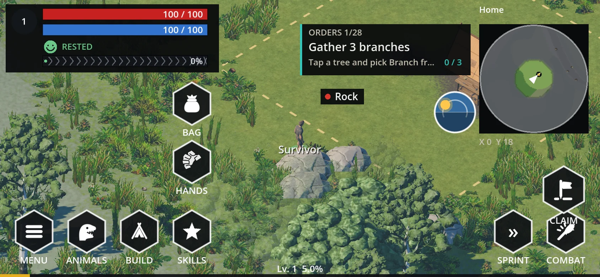
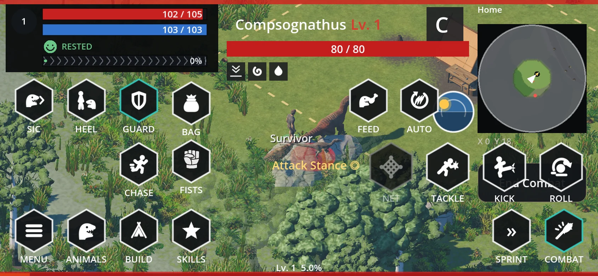
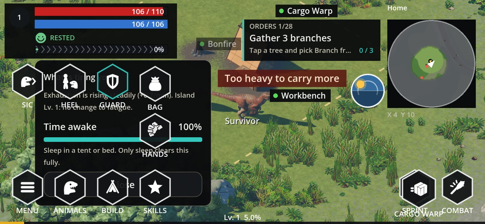
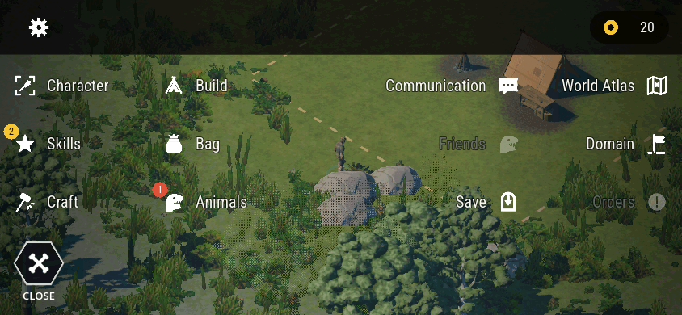

# HUD & vitals UI — the Durango hunt HUD

Owner: `game/scripts/ui/hunt_hud.gd` (drawing, input, state). Split out of it: per-canvas geometry in
`game/scripts/ui/hud_layout.gd`, exhaustion-belt math in `game/scripts/ui/exhaust_treadmill.gd`, the
breakdown panel in `game/scripts/ui/fatigue_panel.gd`, the 24 h dial in
`game/scripts/ui/day_night_dial.gd`, toast/notice state in `game/scripts/ui/hud_event_state.gd`, the
hex control in `game/scripts/ui/hex_button.gd`, the death card in `hunt_hud.gd` itself.
Screens (Map, Animals, Domain, Skills sheet, claim confirm) live on canvas layer 96, the death
screen on 100. Everything is a tap: `_ready` sets `TouchControls.hud_mode = true`.

## Fixed layout (per canvas, `HudLayout`)
- Vitals panel top-left: desktop 300 px wide with 16 px bars and body-size numerals; phone compact
  (min 148 px, the room left of the minimap). An 18 px level disc sits left of the two bars (health
  red, stamina blue). Right of both bars, as tall as the pair (38 px desktop, 30 phone), the stomach
  ring (HUDRULES, owner 2026-10-28; `hud_stomach.gd`): a GOLD ring filled clockwise from the top that
  empties as she gets hungry (LIFE red under 25 %), the white stomach glyph (`stomach.svg`,
  `_src/icons_p.py`) inside. ASSUMPTION: no satiety meter exists (PRD forbids one), so the fill is the
  share of eaten Energy still digesting (`Digestion` rows, remaining / total): full after a meal, empty
  once it is digested. Read only; no hunger rule changed. Below: the exhaustion face + tier word, then the treadmill belt. While Well
  Rested the belt pauses (`ExhaustTreadmill.paused_rate`: the drift eases to 0 in ~0.2 s and holds)
  unless exhaustion is falling right then (a rest or a meal still runs it left); the status row shows
  the Well Rested chip (sun over a pillow, `well_rested.svg`) with its countdown.
- Mounted: the second (energy) bar shows the ridden mount's energy. It turns the darker
  `UiTokens.MOUNT_ENERGY` blue in 10 segments (owner 2026-10-28; ASSUMPTION: a tick every 10 %), and on desktop
  the mount's name leads the numbers (a phone bar shows only the numbers when the name does not fit; the segmented darker blue still says "mount").
  It goes back to the survivor's blue stamina on dismount (`HuntHud.energy_reading`). The exhaustion
  face and treadmill always belong to the survivor, and the mount running does not move them.
- Status chips row under the vitals (HUDRULES, owner 2026-10-28; `hud_buff_row.gd`): **buffs, boons and
  debuffs only** — statuses whose `statuses.json` `kind` is `buff` / `boon` / `debuff`, then the food buffs
  (`BuffSlots` rows, `eat` icon, GOLD rim). Afflictions (`kind: effect`) never show here; they are the boxes
  beside her (below). 30 px pitch, a 1.5 px rim in the status colour, a countdown under 3600 s (longer =
  "until treated"). Each chip has a tooltip (name, BUFF/BOON/DEBUFF, the food buff's stats, the status
  `desc`, time left) on a free spot under the chip off `taken_rects` (`buff_tip` block): desktop hover
  shows it, a click pins / unpins it (GOLD rim while shown); touch: a tap toggles it (the emulated mouse
  press is ignored). On a compact canvas each chip's touch area is 64x64 around it; where neighbours'
  areas overlap the nearest chip wins.
  A status that lowers max HP adds its own note line ("Infected Wound: max HP −20%").
  While she rests or sleeps a Resting chip (rest icon) comes first, and a rounded ink pill right under
  the row (under the max-HP note when it shows) reads what she nets at body size: "Resting by the fire
  / +2.8 HP/s / -15 fatigue/min" (`HudRestBox.draw`, lines from `RestState.hud_lines`; Health red when
  a status takes more than the rest gives). Each second that gives a whole point, "+N HP" (green) and
  "-N fatigue" (teal) floats rise over her (`HudRestBox.tick` → `HudEventState.add_float`).
- The name under the survivor hangs from `HudLayout.nameplate_anchor`: the capsule centre, lowered with
  the visual while she sits or lies, so it stays under her instead of across the torso.
- Minimap top-right: a round 154 px window (`MAP_PX`), drawn camera-up (rotated by camera yaw),
  0.95 m per pixel (`MAP_SCALE`), with fog-of-war, the foot trail, camp flame, harbour anchor,
  crater, creature dots (pets green, wild red, only inside revealed fog) and the player arrow.
  Above it "Home" / "Survivable N min" / "Lab"; below it the X/Y tile readout. A tap opens MapScreen.
- DayNightDial (`day_night_dial.gd`, DAYNIGHT 2026-10-28, the owner's pick of three faces) docked at the
  minimap's bottom-left edge: a gold-rimmed half-dial, 112x76 on desktop, 66x64 on compact canvases (a
  phone keeps the same face with three-hourly ticks, no lens flare). The half-disc sky is painted:
  zenith-to-horizon gradient keyed to WorldLighting's phase times, a warm glow around the sun, a rose
  band that climbs through sunrise and sinks through sunset, and a pulsing bloom for ~14 s either side of
  each. Clouds drift across it with the hours (white by day, rose at dusk, faint slate at night). The sun
  has a corona, turning rays and two lens-flare glints; the moon a halo and craters. They ride one arc,
  sun up 06:14–18:14 (ASSUMPTION: halfway through dawn and dusk), the moon opposite. Stars twinkle from
  ~36 s after sunset to before sunrise, with an occasional shooting star. Two silhouettes, far hills and
  a near treeline, drift at different speeds as the day turns. The rim is engraved with hour ticks
  (06/12/18 longer) and a gleam sweeps along it every ~7 s (faster at sunrise and sunset). Under the dial:
  a 24 h track (night blue, dawn and dusk orange, day gold) with a gold caret at now, and the clock. A
  tap opens the label to the left (phase, clock, time to the next phase), closing after 4 s. It reads
  `Game.time_of_day` / `day_length_seconds` and never writes them. Cost: three triangle-array calls plus
  ~60 small draw commands, ~70 µs a draw headless. It redraws each frame only while stars, a flourish or
  the gleam show, else every 15 game seconds, and its draw allocates nothing (t_daynight). Captures:
  `docs/orchestration/reports/daynight/`.
- Hex sizes follow spec §2 (`HudField.PX`): desktop rail 100, INTERACT 150, ATTACK 100, SPRINT 100,
  quick slot 80, whistle 66, CLAIM 52; compact canvases (`UiTokens.is_compact`: 844x390 and portrait)
  use 64 / 96 / 72 / 64 / 64 / 64 / 64, so every phone tap target is 64 px or more. All flat-top.
- Rail bottom-left (owner 2026-10-28): MENU ≡, BUILD (opens the build drawer, `BuildUI`), BAG, captions under. Skills,
  Animals, Character and Orders are entries in the MENU nav menu (`nav_menu.gd`), not rail hexes. BAG opens the bag (also I).
- MENU notice badge (`HudField.notify` / `HuntHud.notify_menu`): a count in a filled circle at the
  hex's top-right, GOLD with ink text, LIFE red while any notice is urgent (ASSUMPTION, owner
  undecided), "9+" past nine. Skills notices: each skill level-up (`skill_leveled`) and each time SP
  starts to afford a node (`SkillRules.affordable_now`, rechecked every 0.25 s); cleared when Skills
  opens; the nav menu's Skills entry carries the same count as its own badge. Market (buy/sell) notices: the
  hook (`notify_menu(&"market")`) and its badge exist but nothing calls it — the offline market generates no
  client event. Nothing is urgent today.
- Quick slots above the rail: two quick-food hexes (×count, unchanged), CHASE in the third slot in a
  fight, HANDS (held tool; tap gathers nearest, long-press unequips) in the fourth (`hands_spot`).
- Bottom-right (`hud_field.gd`): one large INTERACT hex in the corner. It shows what
  `PlayerInput.interact_choice` picks, rescanned every 0.2 s, and runs a fresh pick on press:
  dismount, sleep (bed, fatigue ≥ 1), pen, OPEN (station), field, fire, butcher (corpse), harbour,
  warp, OPEN (basket), GATHER a node in arm's reach, your pet, DRINK at fresh water, else GATHER the
  nearest resource within 12 m (the Space path; its own item icon in colour). Nothing near: disabled,
  caption INTERACT. The context row leaves out whatever INTERACT shows. No Talk / Pick up entry: no
  NPCs or loose ground items exist (ASSUMPTION).
- ATTACK NEAREST above INTERACT (desktop, portrait; on a landscape phone the map column leaves no
  room there, so it stands above SPRINT, up-left of INTERACT): out of combat it fights the tapped
  selection, else the nearest wild animal in 28 m; in combat it retargets to the nearest enemy.
  Disabled with no animal in range (it never swings at scenery, unlike F). Selected while fighting.
- SPRINT left of INTERACT: a tap toggles it (`Player.toggle_sprint`); keyboard Shift still holds.
- The DEBUG hex shows only while `Game.debug_overlay` (phone: lower-right; desktop: under the dial).
- XP bar 4 px along the bottom edge with the "Lv x, y%" text beside it; the survivor's name draws
  under her feet (15 px, projected from the camera).
- Quest card (HUDRULES, owner 2026-10-28):
  - Collapsed by default into the minimap: a badge over the map's top-left corner (the `notice` glyph and
    the shown order's number, "8/28"; `hud_orders_badge.gd`, drawn by the minimap's own draw so it sits
    over the map). A tap / click on the badge expands the card; a tap on the card collapses it
    (`HuntHud.orders_tap`). Phone touch area 64x64 from the badge's corner over the map. Session-only
    (`OrdersSheet.hud_expanded`): no UI-settings store exists and the save format is off-limits. When
    the order changes, the badge flashes GOLD for 2.4 s.
  - Auto-expand: while she makes progress on the shown order (its fill rises, polled every 0.25 s — a
    gathered branch, a crafted knife) or fights an animal that serves it, the card expands and stays up
    4 s (`ORDERS_AUTO_S`, ASSUMPTION) past the last progress. Collapsing it by hand during that window
    keeps it down until the activity ends (the window runs out).
  - Combat: card and badge hide unless the fight serves the shown order — its `objectives.json` `fight`
    list names the target's creature id, or "*" for any animal (`OrdersSheet.served_by_fight`; shipped:
    meat "*", tame zebraceratops, volcano raid tyrannosaurus). On a landscape phone the target plate owns
    the centre band, so a serving order shows as a 40 px strip (ORDERS i/n, title, progress) on a free
    spot under the chip row (`_draw_quest_strip`), else the badge.
  - Expanded: desktop a 240 px card left of the minimap; phones across the centre band — "ORDERS
  i/n", the step title, hint, progress and a teal fill; when no objectives run: "NOW / island /
  Survive, then return".
  It draws `OrdersSheet.hud_step(player)`: the running order, or a later one the player picked with
  "Track on HUD" in Orders (C4, `orders_sheet.gd`; session-only, a load follows the running order).
  Only the running order completes and pays out (`Objectives.settle`).
- The nav menu's entries: Character, Skills, Orders (`HuntHud.open_character()`, `open_skills(tree)`,
  `open_orders()`), Craft (`craft_ui.gd`), Build (`BuildUI`), Bag, Animals (`open_animals`), World Atlas
  (`open_atlas`), Domain, Communication, Island Market (`open_market(tab)`) and Save; ‹ on those screens
  reopens the MENU (`HuntHud.open_menu`).

## The centre band (`HudLayout.centre_band`)
- Landscape phones: the strip between the vitals and the minimap carries the quest card; the target
  plate and the level-up banner take it over while they show. Portrait: a strip under the map text.
- HUD-owned rects (`drawn_blocks`: vitals, map text, status row, plate, name, toasts…) plus every
  visible hex (with captions), other HUD controls, HANDS and the survivor figure form
  `taken_rects`; moving text picks a free spot via `UiTokens.free_spot` and is skipped when none.

## Combat layer (active while `player.hunt.target` lives)
- 6 px red bands across top and bottom; End Combat button (desktop right at ~42% height; phones
  under the map text / at the whistle row's right).
- Four 72 px skill hexes in a row, ROLL rightmost: NET / TACKLE / KICK / ROLL. With a ranged weapon
  equipped NET becomes FIRE n (ammo count, disabled when out); near a catapult both swap to the
  siege hexes (SIEGE n stone_shot / TOXIN n). Cooldowns and reloads disable their hex.
- AUTO toggles the hunt's auto-attacks; an "Attack Stance ◎" label sits beside the row; CHASE⇄HOLD
  joins the quick-food row; FEED appears on tameable targets (`FieldTame.can_attempt`).
- Whistle row SIC / HEEL / GUARD while a pet is out, selected state mirroring the pet's brain mode:
  desktop a row beside the rail (spec §6); landscape phone a row under the vitals; portrait a
  mid-screen row with End Combat at its right.
- B2 restyle (UIGATHER): the skill hexes, AUTO, FEED and CHASE take the HUD fill and light rim (4 px,
  3 under 70 px); ROLL shows its "Q" key cap on desktop (ASSUMPTION: tactic_1..4 are bound but nothing
  reads them, so no caps on NET / TACKLE / KICK). The NET hex turns GOLD-filled with a dark net and a
  GOLD rim while a throw is allowed (spec 09: stunned or at or under 30 %, and a net and technique cover
  the tier); its bottom line stays empty for a taming-odds figure. The target plate's HP bar turns GOLD
  in the same window, its status chips show icon and name with a rim in the status colour, and a gold
  line by the animal reads "Weaken to 30% to capture" / "Capturable — throw the net!" (drawn before the
  pills, on a free spot off the plates; skipped where none is free).
- Targets [owner 2026-10-28]: out of combat a tap on a wild animal only selects it and the red swords
  hex (or ATTACK NEAREST, E, F) starts the fight; in combat a tap on another enemy switches the target
  to it at once (`PlayerActions.attack`) and no swords hex shows. End Combat disengages.
- Landscape phone combat: End Combat (96x64) in the map column above INTERACT; the four skill hexes
  along the bottom between the rail and SPRINT / ATTACK, their captions clear of the XP line; Auto and
  Feed above the NET / TACKLE seam; the stance text right of Auto. Desktop: the skill cluster sits
  480 px in from the right, left of SPRINT.
- World creature plates (`creature_plates.gd`, 176 px pill): name line, then the animal's NATURE as a
  small chip directly under it (owner 2026-10-28; `ui/nature_chip.gd`, spec §5 trait chip in its gold
  style, short label only — "Timid"), then the HP bar and, on a target or tameable animal, pet XP,
  status glyphs and the tame row. The name never contains the nature ("Alpha Velociraptor" keeps
  "Alpha"). The 176x94 pill is unchanged and the chip row is always reserved, so a plate does not
  resize between creatures; an animal without a nature draws no chip. A landscape phone's bar-only
  plate has no chip.
- Target plate top-centre (≤520 px): creature name + "Lv. n" (pets show their tier), an HP bar, a
  species-letter tile, the target's status chips and a Tyrant's opening label. It lingers on the
  last creature attacked (within 40 m) until it dies or a new one is hit.
- Context hexes (70 px, rescanned every 0.3 s from `player.context_actions()`) offer Wash, Fill,
  Rest, etc. and hide in combat. They run right to left along the bottom from SPRINT (wrapping one row
  up, clear of HANDS). CLAIM is a gold-rim hex (52 px desktop, 64 phone) right-aligned under the
  minimap's "X Y" line; icon-only on a landscape phone (ASSUMPTION: no room for a caption there). Claiming while already
  holding land here opens the ClaimPanel confirm; it cancels on walking away, moving placement, or
  a second tap. Ground-placing anchors a ROTATE / SAVE / CANCEL hex row near the ghost via a
  scored clear-spot sweep (`HudLayout.placer_anchor`), clear of the build drawer (`BuildUI.taken_rects`);
  88 px hexes on desktop, 64 on a phone (UICRAFT, owner §1.9): ROTATE is the icon alone, SAVE a green
  check on an OK_GREEN rim, CANCEL a red cross with the word inside; no key letters. Layout mode
  shows DONE + a hint bar.

## Exhaustion gauge & breakdown
- The face is drawn (smile → deep frown across four tiers, green → red by strain). Under it, a
  16 px treadmill belt (`BELT_H`): chevrons scroll right while exhaustion rises, left while it
  eases; belt speed = 350 px per pt/s of drift, clamped 3–150 px/s, holding still under 0.004 pt/s
  (`RATE_DEAD`).
- Drift is an EMA over fatigue deltas (2.5 s window, `EMA_TAU`). A jump ≥ 8 pts (`STEP_AFTER`)
  counts as a one-off step (sleep, meal), applied instantly, with a faster forgetting window
  (0.8 s `FORGET_TAU` held 2 s) so the belt eases out of the sweep.
- Tapping the face or belt opens FatiguePanel (300 px, refreshing every 0.5 s): up to 4 causes at
  ≥3% share of recent fatigue (each row a name, % and a remedy line), plus a context line with the
  level-gap sentence, the climate shortfall and the live drift ("Exhaustion is falling slowly
  (+x/min)"). Vitals owns the rows; the decay window is `fatigue.breakdown_window_s` (180 s).

## Gather radial and yield card (UIGATHER, spec §4, B1)
- Tapping a node (or its pill) opens `gather_radial.gd`: the node's title and level under it, one
  flat-top hex per option around it — 124 px on desktop, 64 on a compact canvas — with the gather
  seconds on top, the resource symbol greyed in the middle, the node's units left at the bottom, and
  the resource name in a box beside it (21 px on desktop; a locked option reads "Log · Needs an axe" in
  DANGER). The running option's hex pie-fills 0 → 1 per unit (`HexButton.fill_ratio`); the others are
  disabled while it runs. One unit lands per fill.
- A gather started without the fan (INTERACT, Space, a one-option node) opens it on its node with that
  option running (`GatherRadial.show_running`), so the hex carries the progress for every harvest. The
  floating `gather_ring.gd` is retired for harvest nodes (ASSUMPTION, spec open question 7) and stays for
  tame feeding and crafting progress.
- The camera already leans toward the selected or worked node (`Player.camera_interest`, IsoCamera
  `SELECTION_BIAS` 0.35, follow lerp 8/s); UIGATHER leaves those values as they are.
- Yield card (`yield_card.gd`, replaces the top-centre "+n Item" toast and the retired
  `pickup_toast.gd`): on each gain, a 300 px card (220 on a phone) above the worked node — else above
  the survivor (crafts, loot) — on a free spot off `taken_rects` and the open radial, ~3 s or until the
  next gain. Thumbnail tinted with the lot's natural colour (`ItemStack.tint_color`), the item name,
  "Wood · Lv. 1 · +2" (first category, lot level, count in GOLD), then the trait chips of every instance
  that gain added (`InvAttributes.sections`: rare ✦ green first, positive + gold, negative − grey) and a
  3 px top edge in the best chip's colour. GatherFeedback's "+n Item" rise over the node is unchanged.

## Notices, toasts, hits, level-up
- Skill XP lines (left feed, owner §1.6, UIGATHER): under the vitals, one 44 px row per tree gain (34 on
  a phone) — a small hex with the skill's initial, "Gathering +6 XP Lv. 1" and a thin XP bar of that
  tree's progress; a tree level-up is the same row in GOLD with ▲. Each row takes a free spot off
  `taken_rects`. Item gains are the yield card (above); notices
  (refusals) render under them on dark red with a LIFE edge and a drawn warning triangle; a
  confirmation (`HudEventState.add_notice(text, true)`, e.g. the menu's "Game saved · HH:MM") renders
  on the HUD fill with an OK_GREEN edge and a check (`HudEventState.draw_notice`, B4). Nothing covers
  the fixed blocks.
- A creature's hit on the survivor covers her chest with Pokémon-style jaws and red damage numbers (22 px);
  heavy hits flash the screen red.
- Status effects on the survivor (STATUSFX, owner 2026-10-28; `ui/status_fx.gd`, driven from
  `HuntHud._process` / `_draw`). Every look comes from the status's `fx` block in
  `data/statuses.json` (`color`, `icon`, `particles`: drip / bubbles / embers / tint / none,
  `vignette`; `body` keeps the old hint), parsed into `StatusDef.fx_*`; a new status needs only data.
  - Only `kind: effect` statuses (afflictions) get boxes (`StatusFx.effects`); buffs, boons and debuffs
    are the chip row. Particles and tints still follow each status's `fx` block (Hot Food's embers).
  - Boxes: one square per active status beside her figure (`HudLayout.figure_rect`), 10 px off it,
    the first at her shoulders and the rest stacked down (42 px desktop, 32 px on compact canvases).
    HUD ink fill, a 2 px rim and a 4 px time-left bar in the status colour, its white icon inside,
    a stack-count disc on the outer corner. The column keeps its side (right, else left) until that
    side is blocked, slides up/down off `taken_rects` via `UiTokens.free_spot`, is skipped with no
    room, and is a drawn block (`statusfx`) so toasts keep off it. A box that loses the one above it
    glides up (8 slots/s) instead of jumping.
  - Bleed's icon is the claw mark (`claw.svg`, `_src/icons_n.py`); the HUD chip row uses it too.
  - Colours (ASSUMPTION, from the spec tokens; owner 2026-10-28: no green negatives, `UiTokens.HEAL` /
    `UiTokens.POISON`): bleed red (LIFE), venom/poison/sickness/stomachache purple (#a36bd9), hot orange,
    wet/cold blue, positive buffs GOLD, Well Rested soft gold, other negatives MUTED grey.
  - Particles: one CPUParticles3D per status (at most 3, 8-10 unshaded spheres each) under the player,
    freed the frame the status ends: bleed red drips, venom/poison green bubbles, hot food embers
    (ASSUMPTION: no burn status exists). "tint" statuses (fracture, groggy, wet...) draw a faint
    colour glow over her figure instead.
  - Vignette: while a `vignette` status is on (bleed, deep bleed) a red screen edge (14 % of the short
    side, alpha 0.16) brightens to 0.42 on each tick and fades back.
  - Tick numbers: `StatusEffects.ticked(id, amount)` fires per damage-over-time tick on the player with
    the Health it took; `HudEventState.add_tick` floats a 16 px "-N" in the status's fx colour (owner 2026-10-28) ("-0.2" for a fraction) on the
    hit numbers' path (pops in from 70 %, rises, fades); two ticks on one frame stand side by side.
- Level-up (`World.pioneer_changed`): a gold stack at the top-left for ~6 s — level, title line,
  XP, T-stones, SP, per-stat gains; landscape phones show a one-line banner in the centre band
  instead. Gains land via `Vitals.grant_level_bonus` (saved).
- HUD pills (`game/scripts/ui/hud_pills.gd`) label buildings and nodes within 8 m (UIGATHER, spec
  §4.1): a dark box, a harvest node's pill leading with its resource symbol greyed (dimmed when picked
  clean, red-tinted without the tool), 30 px tall with 18 px type on desktop, 22 / 14 on a phone. A
  harvest pill is tappable (`HudPills.node_at` from `HuntHud._input`): it selects the node exactly like
  a tap on the node (opens the gather radial, the camera leans toward it). The domain
  banner (`domain_banner.gd`) announces "<owner>'s Domain" entering claimed land; your own portrait
  there is `PortraitService.of_player()` (a headshot of your character look), others a silhouette. All of it yields
  to toasts, plates and the open sheets.
- Death: full-screen layer — "YOU DIED" in LIFE, the downer ("Downed by <who>."), the note "Engaged
  dinosaurs retreat past their aggro ring. Your bag comes with you." and a GOLD "Respawn at camp" on a
  HUD-fill card with a LIFE top edge (B4).
- MENU opens the nav menu (`game/scripts/ui/nav_menu.gd`, spec §7 B3): Character, Skills, Craft,
  Build, Bag, Animals down the left (icon, label), World Atlas, Domain, Orders, Communication,
  Friends, Save down the right (label, icon), a header band with a settings gear (holds the debug-info
  toggle, ASSUMPTION) and the T-stone balance, and a CLOSE hex where MENU sits. It draws on canvas
  layer 90 and fades the HUD's own drawing and hexes out while open; the world keeps running. A tap
  on the world, CLOSE or Esc closes it. Each entry badges notices of its own kind
  (`HudField.notices`, GOLD / LIFE). No entry is greyed today (`NavMenu.DISABLED` is empty): Orders opens
  its own sheet and the Friends slot holds Island Market (ASSUMPTION, `nav_menu.gd` RIGHT — Friends has no
  system yet); Character opens the Character screen the bag's Character tab also opens, Communication the
  Domain screen's Communications Center. Compact canvases fold each side into two columns of three 72 px rows.
- Sheets (BUILD / structure cards; Animals is its own screen) stand on the rail and grow upward, wading into
  scrolling when short; landscape phones lay them out as a two-column grid. HANDS and the creature
  plates hide while one (or the nav menu) is open.

## Screens (phone landscape, [all screens](ui-screens.md))

**Idle HUD**

**Pet out**

**Combat layer**

**Fatigue panel**

**MENU nav menu** (B3; desktop 1600x900 capture:
[`../orchestration/reports/uinav/b3_nav_menu_1600x900.png`](../orchestration/reports/uinav/b3_nav_menu_1600x900.png))

## Tokens used by the field HUD and the sheets

`game/scripts/ui/ui_tokens.gd` carries the hex-HUD language from
[`../design/ui-redesign-spec.md`](../design/ui-redesign-spec.md) §2/§3/§8. The field controls (rail,
INTERACT / ATTACK / SPRINT, context hexes, CLAIM) use `HUD_RIM` / `GOLD` rims and the MENU badge
`GOLD` / `LIFE` / `CTA_INK`; the sheets share the same token set through `sheet_chrome.gd` /
`uichar_chrome.gd` (see [ui-screens.md](ui-screens.md)).

- Palette: `HUD_FILL`, `HUD_RIM`, `HEADER`, `SCREEN_DIM`, `PANEL`, `GOLD`, `GOLD_DIM`, `CTA_INK`,
  `PARCHMENT_TOP` / `PARCHMENT_BOTTOM` / `PARCHMENT_INK`, `OK_GREEN`, `LIFE`, `ENERGY`, `XP`, `MUTED`;
  the old `INK`, `TEAL`, `DIVIDER`, `DANGER`, `TEXT`, `META` are unchanged.
- Trait chips: `TRAIT_NEG_*` (grey = negative), `TRAIT_POS_*` (yellow = positive), `TRAIT_RARE_*`
  (green = rare), with `trait_chip_style(polarity)` (0 radius, 3x8 padding) and `trait_chip_prefix()`
  (`−`, `+`, U+2726). Exhaustion tints: `MOOD[4]`. Type: `ui_font(400/700)`, `ui_face()` over
  `res://assets/fonts/RobotoCondensed-Variable.ttf` (shipped).
- Hex geometry: `HEX_FLAT_TOP` (true, owner decision 2026-10-28), `hex_points(center, r, flat_top)`,
  `hex_radius_at(a, r, flat_top)`, `pie_points(center, r, f, flat_top)` — the gather pie fill.
- Chrome: `draw_brackets(ci, rect)` (18 px gold corners), `header_style()`, `draw_torn_edge()`
  (0-12 px zig-zag).
- `HexButton` gained `flat_top`, `rim_color` / `rim_width`, `fill_ratio` (a pie, separate from
  `cooldown`), `icon_grey` and `key_hint` (a boxed key cap, hidden on phones). Its defaults still draw
  exactly the shipped hex apart from the orientation: **the default hex is now flat-top**, so every
  hex on this HUD draws 2r wide and sqrt(3)r tall (rail, quick food, sprint/combat, radials, the
  placement row). `hex_rect()` follows it, so the layout's hex boxes changed shape with it.
