# UI screens — what every screen looks like today

Every screen the build opens, captured from the real home island in the landscape phone layout
(844x390 logical canvas, drawn at 2x = 1688x780). Regenerate after any UI change:
`tools/ui_screens.sh` (runs `game/scripts/dev/ui_screens_lab.gd` windowed; full PNGs go flat to
`~/Documents/deadfront-ui-screens/`, WebP copies to `docs/current/screens/`). The lab walks the UI
gate lab's screens (`ui_real_capture_lab.gd`) with its checks off, then the ones it does not open.

Every full-screen screen is opened from the MENU nav menu (`game/scripts/ui/nav_menu.gd`, B3):
Character, Skills, Craft, Build, Bag, Animals on the left; World Atlas, Domain, Orders,
Communication, Island Market, Save on the right. Each screen's ‹ returns to the menu; ✕ or Esc goes
back to the HUD. `HuntHud` holds the entry points (`open_character`, `open_skills(tree)`,
`open_orders`, `open_animals(rec)`, `open_atlas`, `open_market(tab)`, `open_menu`). The menu draws on
canvas layer 90 with the HUD faded out; screens sit on layer 96.

## HUD

**`hud`** — idle HUD: vitals, fatigue belt, quest card, minimap, day/night dial, hex rail

**`hud_daynight`** — day/night dial label open

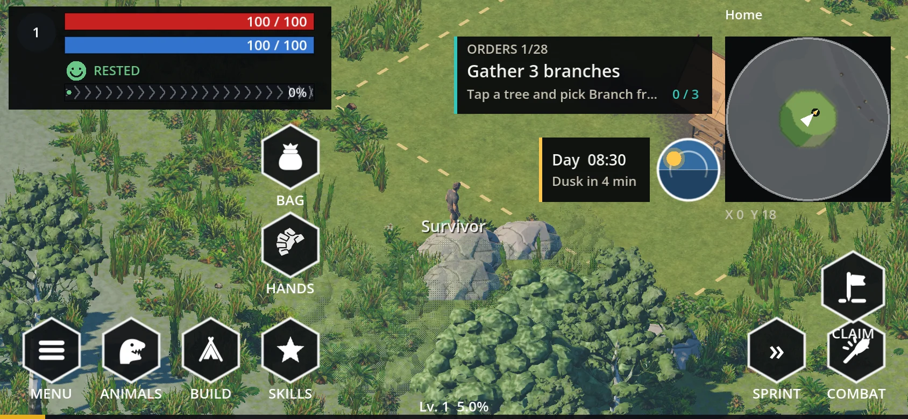

**`radial`** — gather radial on a resource

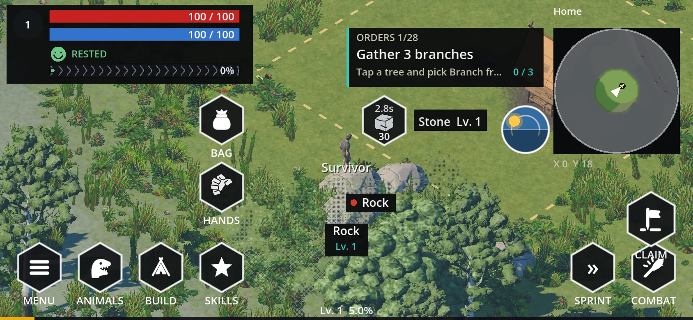

**`levelup`** — level-up banner

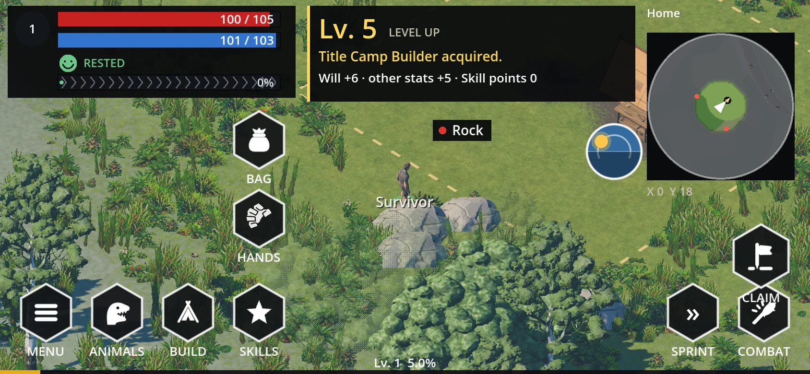

**`busy`** — pickup toasts and notices over the HUD

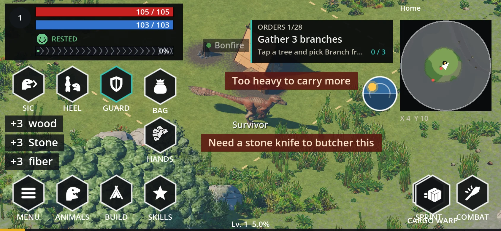

**`busy_levelup`** — toasts and notices over a level-up

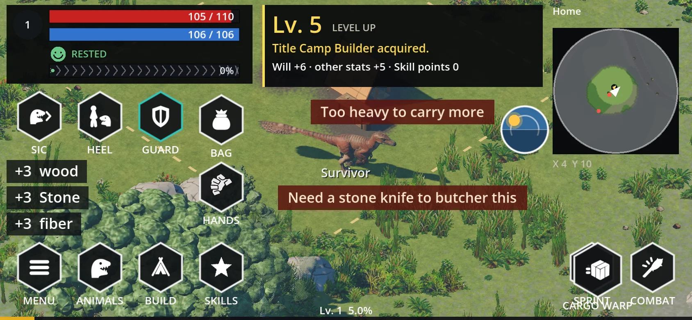

**`fatigue`** — "what is tiring you" panel (tap the fatigue gauge)

**`sheet_menu`** — MENU nav menu (B3, `nav_menu.gd`): two columns of entries over the live world,
header with the debug gear and T-stone balance, CLOSE where MENU sits. The WebP below predates it
(old row sheet); current captures at both sizes are in `docs/orchestration/reports/uinav/` (b3_nav_menu_1600x900.png, b3_nav_menu_844x390.png).

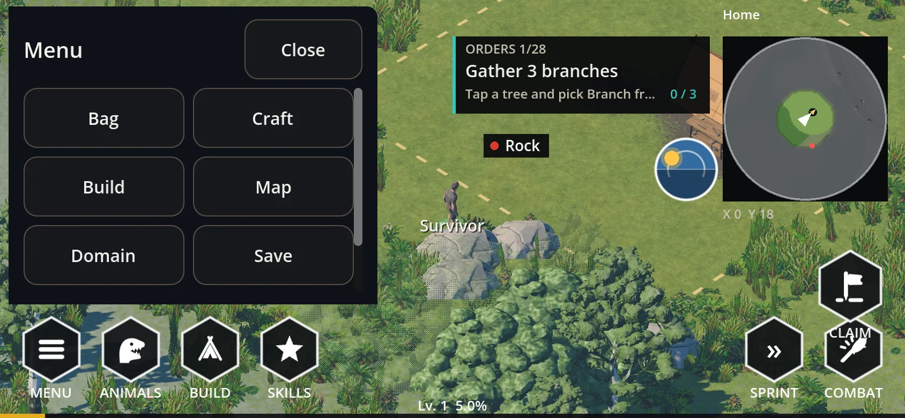

**`sheet_build`** — BUILD sheet

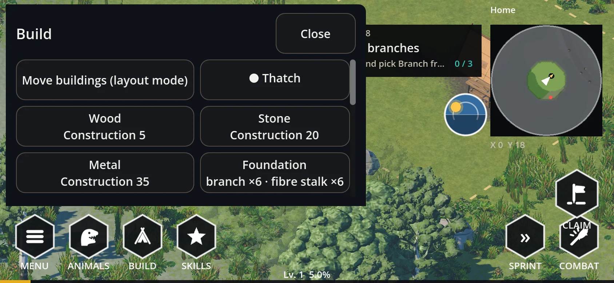

## Bag & items

**`bag`** — bag (its Character tab now opens the Character sheet above)

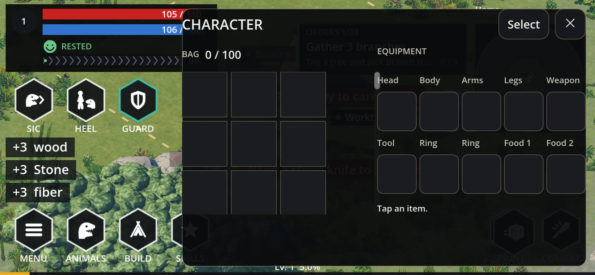

**`bag_food_inspect`** — food inspector (Grilled Meat selected)

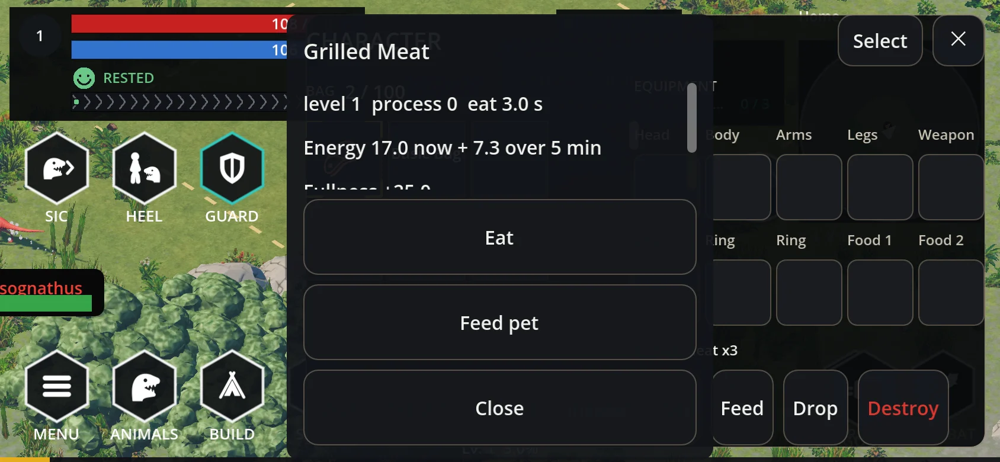

**`bag_bag_inspect`** — bag inspector (Basic Bag selected)

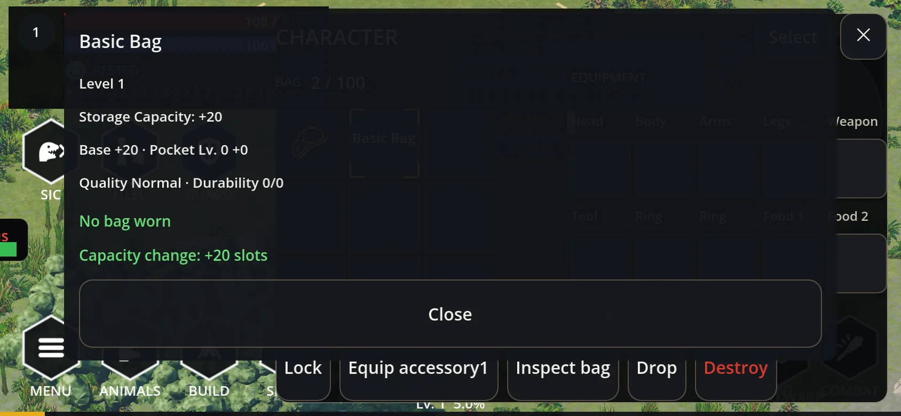

## Crafting, stations, building

**`craft`** — Craft / Build (UICRAFT, spec §7 D1 / D3; `craft_ui.gd`, `craft_place.gd`)

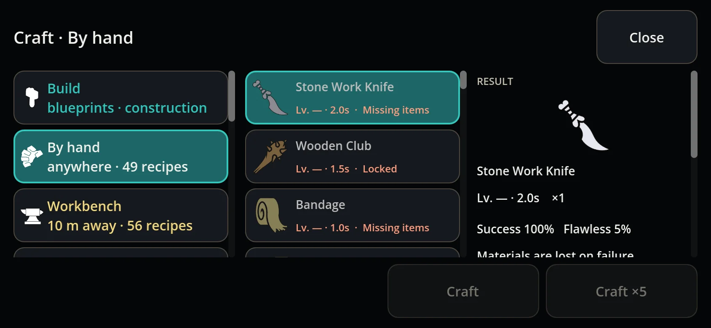

Full-screen sheet: HEADER bar with torn edge, Back, "Craft / Build", the station hint (desktop),
Build and ✕. Left: station chooser (By hand / Workbench n m / Bonfire n m ..., scrolls sideways;
the chosen one gold-rimmed) over a 2-column category grid (All + the six recipe `skill` values; gold
brackets on the chosen tile). Middle: search over the recipe list grouped by what it makes (tool
class, else the output's first category), two cells a row, gold brackets + wash on the selection.
Right: parchment header, level · time · count, Max Level / Related Skill / Station / Time · Success ·
Flawless, the skill lock line, the Materials bar with ✓/✕ have / need rows, the CRAFTFEEL stake lines
and bag preview, and Craft (GOLD) / Craft ×5 pinned under the scroll. "Materials · Place materials"
opens **place materials** (D3): completion %, one chevron per slot (OK_GREEN once placed), the
slot's candidates (level, rarity pips, gold order badges), a parchment focus card with trait chips,
the expected result (traits from slot 1 only), a 1-10 stepper, the success rate, then Place
material → Craft; the placed instances lead their slots (`StationCraft.begin(..., uids)`).
Shots: `docs/orchestration/reports/uicraft/`. Every tap target is 64 px or more at 1600x900 and
844x390 (`game/tests/t_uicraft.gd`).

**`camp_bonfire`** — camp labels by the bonfire

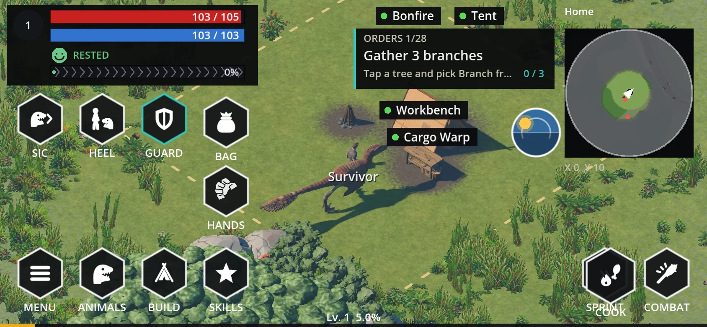

**`station_bonfire`** — bonfire station menu

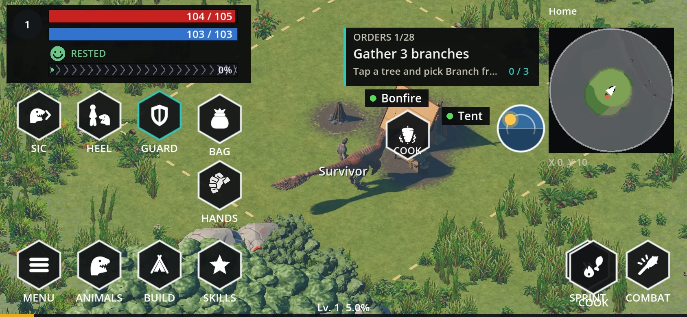

**`camp_workbench`** — camp labels by the workbench

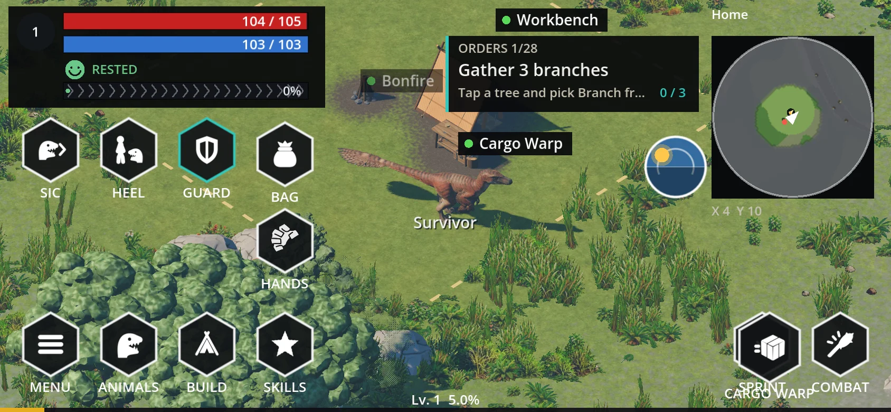

**`station_workbench`** — workbench station menu

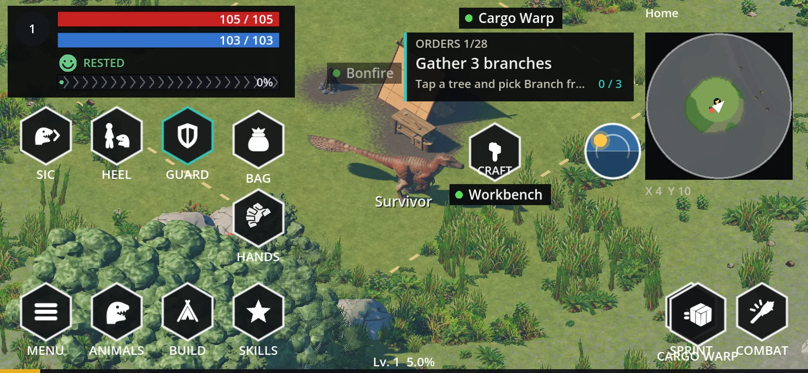

**`build`** — build mode drawer (UICRAFT, spec §7 D2; `build_ui.gd`)

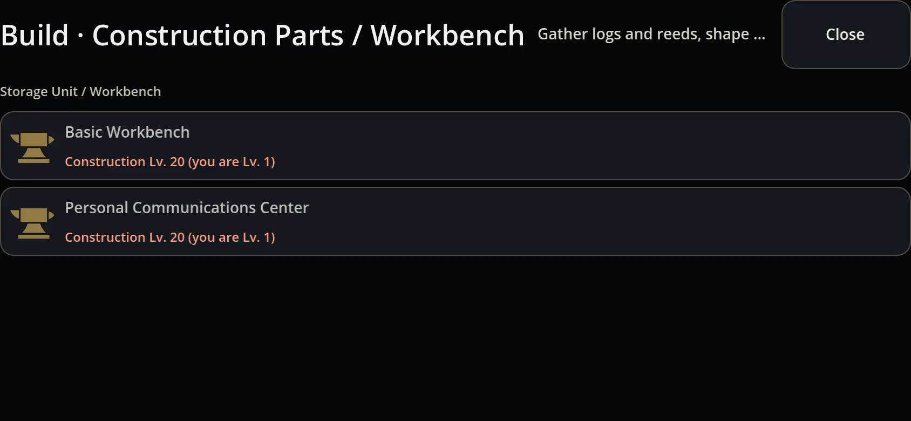

Opened by the BUILD rail hex, MENU › Build or Craft / Build's Build button. An opaque drawer down
the left edge (494 px desktop, 312 phone): "Build", Move buildings, ✕; tier tabs Thatch Lv. 1 /
Wood Constr. 5 / Stone Constr. 20 / Metal Constr. 35 (`structures.json`; GOLD underline on the
chosen tier, red level when locked); flat-top hex tiles under Parts (the tier's pieces, cost
under the name), Stations (kits in the bag) and Blueprints (construction sites); the tier's materials
in the bag and the Construction level along the bottom. A tile starts the ghost and the drawer stays
open: "Pick a building spot" over the world, the cost bar at the bottom (in the drawer's bottom line
on a phone), and the HUD's ROTATE / SAVE / CANCEL row beside the ghost, kept off the drawer. A
construction site's sheet (slots, Work / Withdraw / Cancel site / Finish) opens in the same drawer.
The old BUILD bottom sheet (`sheet_build`) is still built by `HuntHud._toggle_sheet(&"build")`, but no
player control opens it any more: only the dev labs call it (`game/scripts/dev/ui_real_capture_lab.gd`,
`game/scripts/dev/web_soak.gd`).

## Shared sheet chrome (UICHROME, 2026-10-28)

One helper draws the §8 chrome of every full-screen sheet: `game/scripts/ui/sheet_chrome.gd`
(`SheetChrome`). Header band 88 px desktop / 64 px phone (plus the top safe inset), HEADER fill with
the torn edge hanging under it; thin stroke ‹ (back, to the MENU) and ✕ (to the HUD) as 64 px
targets; title in Roboto Condensed 500 at 40 / 26 px; header tabs with a GOLD 3 px underline when on;
a counter and a `right` slot (pills, presets, Build) that grow leftwards, a hairline before ✕. Body
parts: `backdrop()` (blurred world + SCREEN_DIM), `panel_style()` / `panel()`, `parchment_style()`,
`gold_button()` / `ghost_button()` / `action_button()` / `style_action()`, `Brackets`, `Card`,
`label()` / `text()`, `chip()`, `thin_bar()`. Three ways in: a `SheetChrome` instance (Animals,
Harbour, Market, Craft), `build()` + `fit()` (Character, Skills, Orders), the `UiWorldSheet` base
(Domain, Communication, Radio University, Taming Pen). The World Atlas uses its backdrop, cards and ✕
only. `tests/t_uichrome.gd` checks the three paths match and that nothing else draws a torn header.
Shots: `docs/orchestration/reports/uichrome/`.

## Character, Skills, Orders (UICHAR, spec §7 C1/C3/C4)

Full-screen sheets with the shared §8 chrome (`SheetChrome.build()` / `fit()`, see "Shared sheet
chrome" below).
‹ reopens the MENU; ✕ / Esc returns to the HUD. Captures:
`docs/orchestration/reports/uichar/*_1600x900.png` and `*_844x390.png` (`--lab=uichar_lab`).

- **Character** (`character_sheet.gd`, hosted by the bag's `InventoryUI`; open with
  `HuntHud.open_character()` / `InventoryUI.open_character()` / the bag's Character tab). Tabs
  Equipment / Titles / Appearance (Appearance: "No decorative gear yet"). Left: name, level, occupation
  and title on parchment, then the stats list (Life, Energy, Attack, Defense, Accuracy, Critical chance,
  Held tool power, Heat / Cold resistance, the three Powers, Carry, Skill points). Centre: the figure
  (the survivor's portrait) with Head, Body, Arms, Legs left, Weapon, Tool, Ring, Bag right and Food 1,
  Food 2 under it; the selected slot's bar (name · Lv. · Attack · durability, Unequip, Open bag ›).
  Gear sets 1-4 sit in the header. Right: Survival (Exhaustion meter; Food, Thirst, Hygiene as status
  states, since the build has no hunger, thirst or hygiene meters) and a status footer. On 844x390
  the slot labels move inside empty slots.
- **Skills** (`skills_sheet.gd`; `HuntHud.open_skills(tree)`). A 4-column grid of the 12 skills (name,
  gold unread dot when a node is buyable now, white symbol, thin XP bar, Lv., "FULL · n XP" when XP is
  banked at the cap); right, the selected skill: parchment name + Lv., Skill XP, SP spent here, what
  levels it, the unlock list (Unlock / Refund / lock reason per node, auto-learned line, not-in-game
  rows) and the GOLD "Spend n SP on <next node>". F7 `skill_debug.gd` is unchanged.
- **Orders** (`orders_sheet.gd`; `HuntHud.open_orders()`). The standing orders of
  `data/world/objectives.json`: numbered rows (check when done, gold ring on the running one), title,
  hint, progress; right, the parchment title, how-to line, reward chips (+XP, +T-stones) and
  "Track on HUD" / "Tracking on HUD" / "Done".

**`skills`** — skills sheet (pre-UICHAR capture; recapture with `tools/ui_screens.sh`)

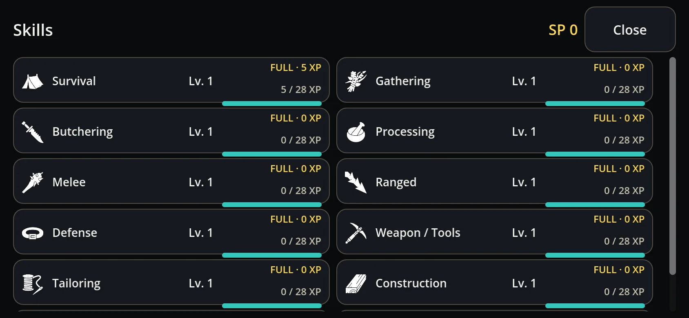

## Creatures, pets, combat

**`animals`** — E1 Animals (UIANIMALS rebuild, `animal_screen.gd`; spec §7 E1). Sheet chrome
(shared `SheetChrome`, see below: ‹ -> MENU, ✕ -> HUD,
tabs Pack / Taming Pen (disabled: no E2 screen yet), counter "Bonded n / cap (grows to 7)").
Left: pack slots = the bonded roster (spec 09 cap 3-7), one card per pet (swatch, name, NatureChip
directly under it, "Species · Lv. n · grade", status Out / Resting / Down / hungry), empty slots up to
the cap, one "n – 7 · locked" row, then "Waiting to bond" (captured / tamed animal items in the bag and
occupied taming pens). Centre: name, NatureChip, species · diet, grade box, the pet's live 3D model
(`animal_stage.gd`, drag to turn), growth XP bar, role and potential chips. Right: stats (with the
genetics tier), needs (fullness, health), Feed (GOLD) / Ride / Summon-Dismiss / Release (disabled: no
bond-breaking exists). Open: `HuntHud.open_animals(rec = null)`. The wiki shot below predates the
rebuild; current shots: `../orchestration/reports/uianimals/e1-animals-*.png`.

**`pet_out`** — HUD with a bonded pet out (SIC / HEEL / GUARD)

**`plate`** — creature plate, idle

**`plate_front`** — creature plate in front of the survivor

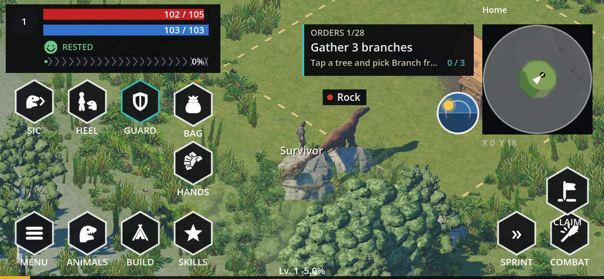

**`plate_zoom`** — creature plate, cropped close

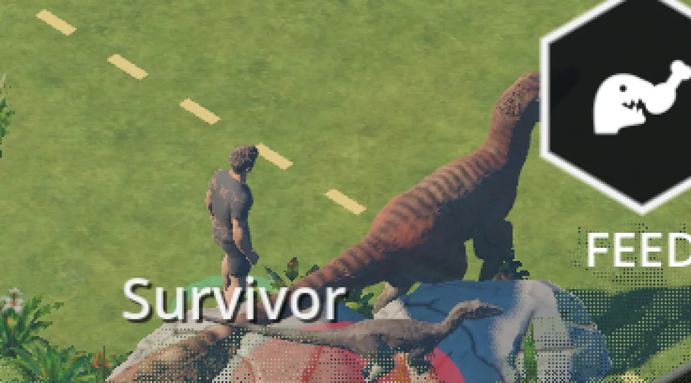

**`combat`** — combat layer in a hunt

## Map, land, island

**`atlas`** — F2 World Atlas (UIANIMALS rebuild, `map_screen.gd`; spec §7 F2). Left column: "World
Atlas", "You X · Y · Lv. · T-stones", one card per catalogue island (current first, GOLD brackets on the
selected; level · climate · Tamed/Unstable, resources, species, status: You are here / Harbour route ·
n T-stones / Needs Survival n), foot: Island time, Islands visited, GOLD "Back to camp" on an unstable
island. Centre: the north-up map on its own sea colour. Right: compass + ✕, legend panel, Harbour
routes (+ Warp home away from home) and zoom − / +. Open: `HuntHud.open_atlas()` (opens) or
`open_map()` (toggles). Current shots: `../orchestration/reports/uianimals/f2-world-atlas-*.png`.

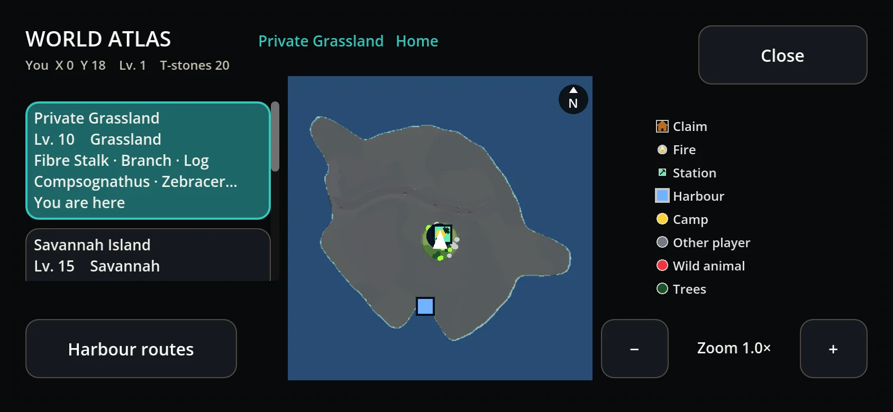

**`harbour`** — Harbour (`world_ui.gd show_harbour()`; owner §11 rebuilt the stretched "Sail ..." rows):
sheet chrome "Harbour" with "Survival n · T-stones n", then a 4-column (phone: 3) grid of route cards:
island, level · climate, the requirement line (red when short), and a Sail button (GOLD when it can
go, `route_id` meta, disabled with the reason on the card). Away from home: Free return home and
Return to camp cards first. Back returns to the atlas. Shots:
`../orchestration/reports/uianimals/f2-harbour-*.png`.

**`claim`** — CLAIM confirm panel (B4 restyle: parchment header, Cancel outlined, GOLD Expand;
current captures in `docs/orchestration/reports/uinav/`)

UNCLAIM (owner: "Also need a way to unclaim land too", 2026-10-28): the same panel in **release
mode** (`ClaimPanel.open_release`). A CLAIM press while standing on one of your own Domain plots asks
`Release this plot?` instead of offering an expansion: the body names the plot's size and cell, how
many plots you keep, that it stops being yours and can be claimed again later, what happens to
anything built there, and that no claim stake is refunded. **Keep** (Cancel) changes nothing; only
**Release plot** (GOLD, 64 px) gives the one plot up, through `IslandClaims.release_cell`. The panel
is 3 short lines of body text so it still reads on a landscape phone's 166 px strip. Rules
(spec 29 is silent, so `# ASSUMPTION`): the last plot is refused, the camp's own landing plot is
never a Domain plot, a plot with a building on it (a kit, a construction site or a modular piece) is
refused until it is packed up, and a release that would cut the Domain into two pieces is refused;
no T-stones or claim stakes are refunded and there is no cooldown. Test: `game/tests/t_unclaim.gd`.

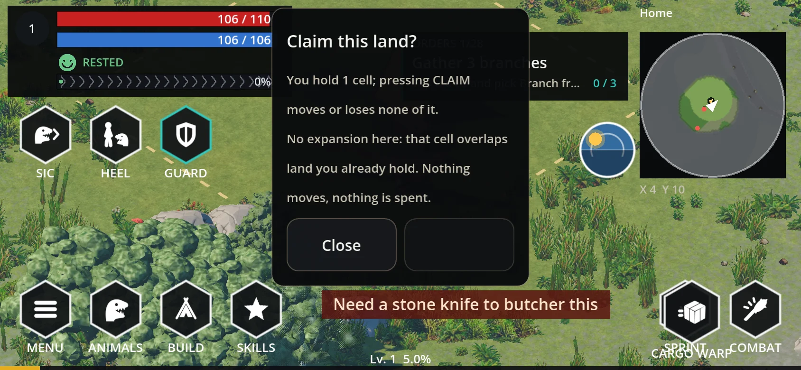

**`domain`** — Domain screen (Menu -> Domain)

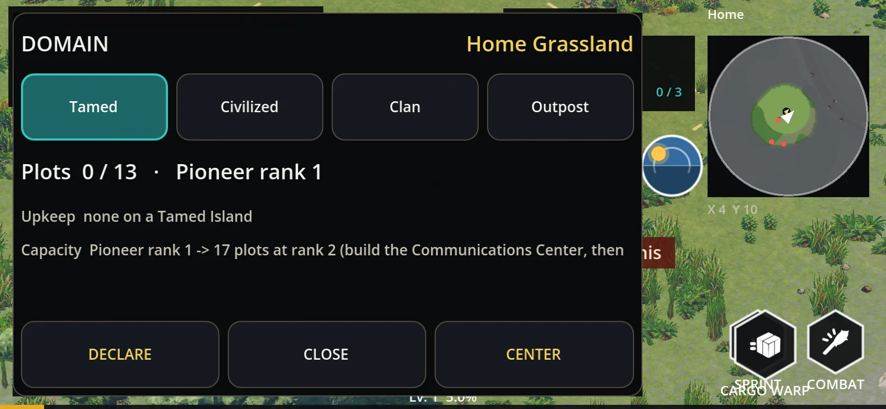

**`comm_center`** — Communications Center contribution panel

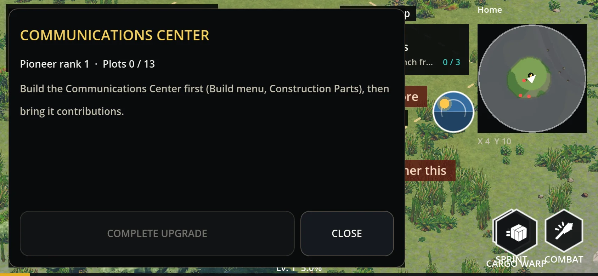

## Island Market

Menu -> Island Market (`HuntHud.open_market(tab)`, or `MarketScreen.open_for(host, tab, uid)` for any
nav menu). Scripts: `game/scripts/ui/market/` (`market_screen.gd` chrome, rail, offline card;
`market_buy.gd`, `market_mine.gd`, `market_sell.gd`; `market_row.gd` one row = one instance;
`market_confirm.gd`). §8 chrome: HEADER bar with ‹ and the island name, the T-stones pill, ✕, torn
edge; left rail Buy / My Market / Sell (GOLD brackets on the active tab). The market lives on the
game server only: in the single-player build every tab shows an **Island Market offline** card and
sends nothing (owner 2026-10-20). Screens with listings come from the local test server
(`scripts/dev/market_harness.gd`, labelled "Local test server, not the live market" on the rail).
Test: `game/tests/t_uimarket.gd`. Shots (1600x900 and 844x390): `docs/orchestration/reports/uimarket/`.

- **Buy**: category column (View All, Tools, Weapons, Food, Wood, Stone, Fibre, Bone, Hide, Animals),
  search field, Level / Durability / Price sort headers (active one GOLD), one row per listed instance
  (icon in its natural tint, gold name, type line, Lv., cur/max durability, coin + price). A row opens
  the confirm: parchment header, trait chips, seller, price, tradable T-stones, **Buy for n** (one unit).
- **My Market**: Active (tap to cancel) / Sold / Expired / History, "n waiting" and **Receive All**
  (withdraws everything in market storage into the server bag, one rid per item).
- **Sell**: the server character's bag and bonded animals (equipped gear left out, locked rows greyed),
  price field, duration (12/24/48/72 h, default 24), fee / tax-when-sold / you-receive preview from
  `market_rules.json`, GOLD **List on market** (deposit + list exactly one unit).

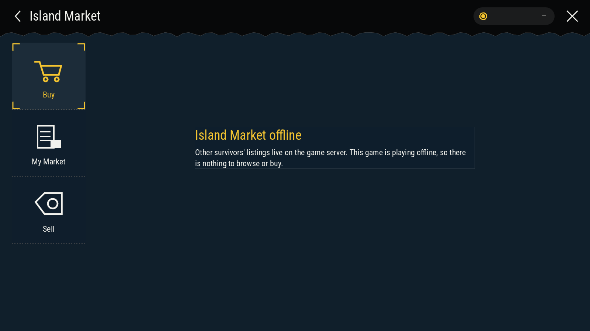
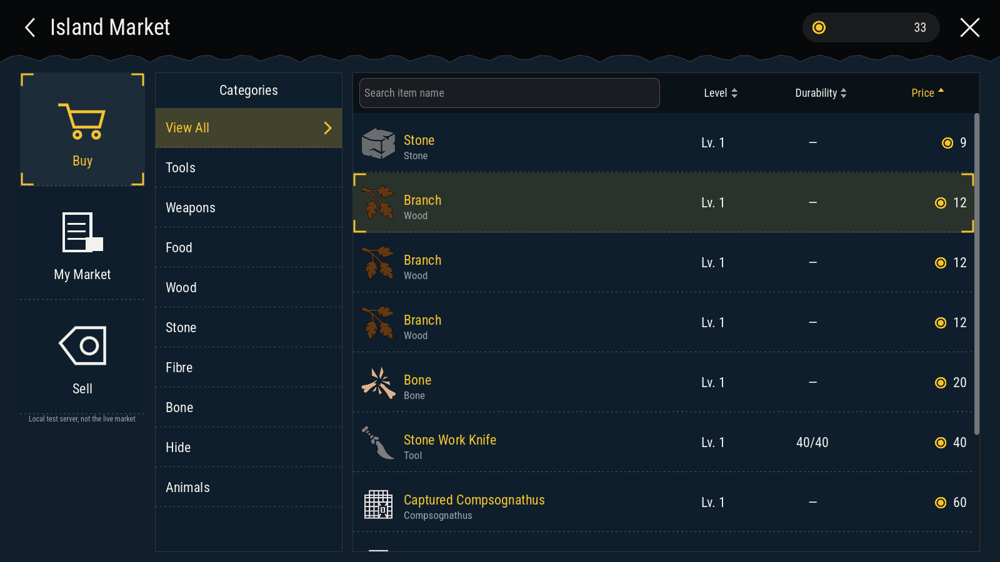

## New character

**`charcreate`** — character creation (spec 19): Gender/Profession, Create Character (height, portrait
pattern/background, Colour tab), Name (1-20 chars), then the Tamed Island pick. The shot predates the
CHARCREATE restyle; recapture it.

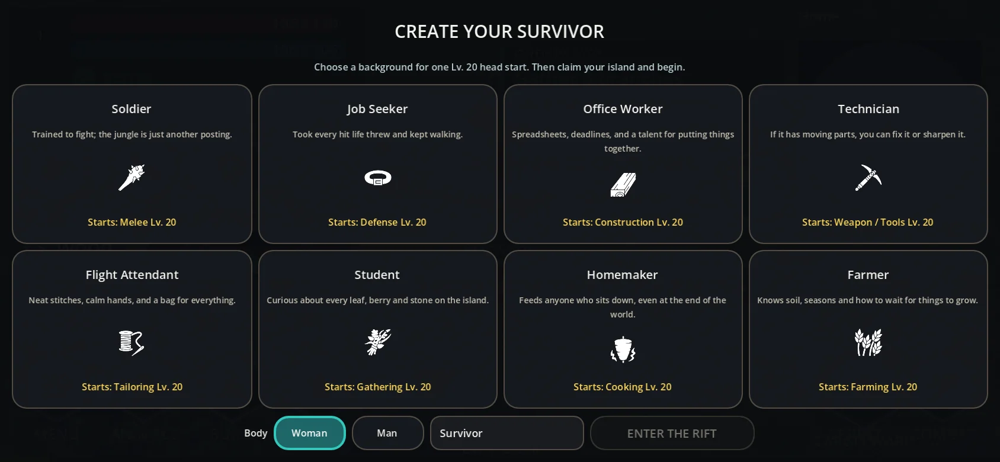

**`island_pick`** — Tamed Island terrain pick

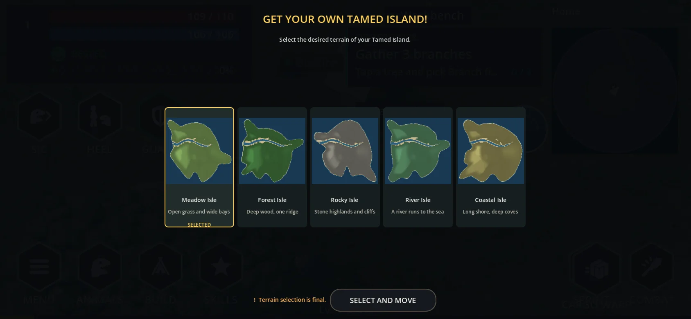

## Restyled world screens (UIWORLD, 2026-10-28)

Built to [`../design/ui-redesign-spec.md`](../design/ui-redesign-spec.md) §7 F1 / F3 / E2 / A2 on the
`UiWorldSheet` base (`game/scripts/ui/uiworld_sheet.gd`: open/relayout lifecycle on the shared
`SheetChrome`, GOLD-numbered rich counter in the header's right slot). Shots at 1600x900 and 844x390: `docs/orchestration/reports/uiworld/`; lab
`game/scripts/dev/uiworld_lab.gd`; test `game/tests/t_uiworld.gd`.

| Screen | Script | Opened by | What it shows |
|---|---|---|---|
| F1 Domain | `domain_screen.gd` | `HuntHud.open_domain()` | Left icon tabs (Tamed / Civilized / Clan / Outpost locked). No domain: GOLD headline, body, quote, **Declare Domain**, island art. Domain held: 7x7 plot grid (Domain GOLD, can-expand outline, water blue, camp land), Plots used/cap, Pioneer rank, upkeep, plot size, next rank, **Communications Center →** (spec-29 contribution panel), Expand / Build here / **Release plot**. Declare and Expand step aside to a Confirm / Cancel card over the ground preview. Footer: the edge-adjacent growth rule. UNCLAIM: a tap on a gold plot picks it (white frame), Release plot asks in the same card with the ClaimPanel's consequence text (Confirm **Release plot** / Cancel **Keep**), and only that confirm gives the one plot up; the old whole-Domain wipe is gone. |
| F3 Communication | `comms_ui.gd` | `HuntHud.open_comms()` | Five factions from `data/world/factions.json` with a trust bar each; selected faction's parchment header (name, tone), three offers from its mission pool with Accept, support-crate band, Reroll offers / Contribute → / Track on HUD; header "Active missions 0 / 4 · Free rerolls 3". No mission or trust logic exists: trust is rank 0, Accept/Reroll/Track are disabled and say why. |
| F3 Radio University | `radio_university_ui.gd` | `HuntHud.open_radio_university()` or Communication → Radio University | Dr. Lamar, career guides only (seven from data, +2 SP each), no crates; progress is not tracked yet. Back returns to Communication. |
| E2 Taming Pen | `taming_pen_ui.gd` | tapping a pen (`PlayerActions.pen_interact` → `HuntHud.open_taming_pen(pen)`) | Left: captured animal (species, level, nature, pack n / cap, diet and role tiles, clade line, food and pen time). Right: "Tame it now, or keep it caged?", pen space n / 1, read-only mood slider with the pen time, pen grid (pen occupant + every caged animal in the bag, tap to pick), Store / Tame; once running: "Taming started", live countdown, Feed meat / OK. |
| A2 Island pick | `island_pick.gd` | character creation | Square cards on a sea well, GOLD brackets on the pick, blurb and top scatter kinds, "! Terrain choice is final.", GOLD **Select and move**. |

Not captured: the death/respawn ring and the skill debug overlay (dev only).
B4 toasts, radials and dialogs (UINAV, `game/scripts/dev/uinav_lab.gd`, desktop 1600x900 and phone
844x390 in `docs/orchestration/reports/uinav/`): warnings on dark red with a warning glyph and green
ok notices, the station radial (main action gold-rimmed, 96 px hexes on desktop), eating as a hex
pie with seconds left and the food's energy, the pet respawn ring (dark red disc, LIFE arc,
"seconds"), the fatigue panel and the death card.

B1 field HUD and gathering, B2 combat and net ready (UIGATHER, `game/scripts/dev/uigather_lab.gd`,
desktop 1600x900 and phone 844x390 in `docs/orchestration/reports/uigather/`): tappable harvest pills,
the hex gather fan with the running hex pie-filled, the yield card and the left XP feed; the restyled
combat hexes with the NET hex GOLD inside the capture window, the gold target bar and the capture line.

Not captured by `tools/ui_screens.sh`: the death card, the respawn ring and the skill debug overlay (dev only).

## Tokens used by the restyled sheets

`game/scripts/ui/ui_tokens.gd` carries the token set and chrome helpers of
[`../design/ui-redesign-spec.md`](../design/ui-redesign-spec.md) §2/§8. The sheets use them:
`sheet_chrome.gd` and `uichar_chrome.gd` build the HEADER bar, torn edge, dim and back/close for the
Character, Skills, Orders, Animals, Atlas, Harbour, Market and Craft screens, `craft_ui.gd` its own
header, `market/market_screen.gd` the rail; the older row sheets and the field HUD still draw their
own colours.

- Palette: `HUD_FILL`, `HUD_RIM`, `HEADER`, `SCREEN_DIM`, `PANEL`, `GOLD`, `GOLD_DIM`, `CTA_INK`,
  `PARCHMENT_TOP` / `PARCHMENT_BOTTOM` / `PARCHMENT_INK`, `OK_GREEN`, `LIFE`, `ENERGY`, `XP`, `MUTED`;
  existing `INK` / `TEAL` / `DIVIDER` unchanged.
- Chrome: `header_style()` (the HEADER bar) with `draw_torn_edge()` under it, `draw_brackets()` for a
  selection (four 18 px GOLD corners), `trait_chip_style(polarity)` / `trait_chip_prefix()` for the
  grey / yellow / green trait chips, and `ui_font(400|700)` / `ui_face()` for Roboto Condensed
  (`game/assets/fonts/RobotoCondensed-Variable.ttf`), with the engine fallback when it is missing.
- `HexButton` (also used by the sheets) has `flat_top`, `rim_color` / `rim_width`, `fill_ratio`,
  `icon_grey` and `key_hint`; a hex that sets `rim_color` selects in GOLD instead of TEAL. Defaults
  keep the shipped look; the one global change is that default hexes are flat-top (`HEX_FLAT_TOP`).
