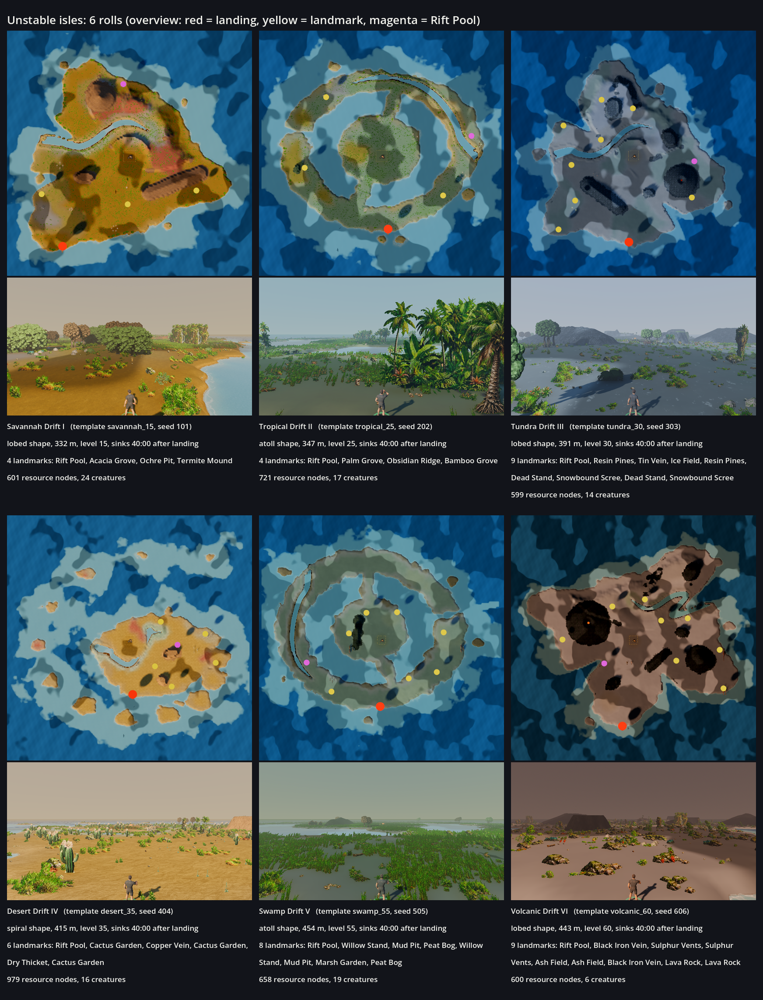

# Unstable isles (generated islands)

An unstable isle is an island the game rolls from a seed on the spot. You can stay on it for 40 minutes,
then it sinks and is gone for good. It is a short, risky trip that pays better than the fixed islands.
Design: `docs/design/unstable-isles.md`. Code: `World.roll_drift` / `tick_drifts` / `sink_drift`
(`game/scripts/core/world.gd`), numbers in `game/data/world/rules.json` `"unstable_isles"`.



*Six rolls, one per template (`docs/orchestration/reports/isleshow/`, facts in `summary.txt`). Top: the
whole isle from above, with red = landing dock, yellow = landmarks, magenta = Rift Pool. Bottom: what
the survivor sees on landing.*

## What the generator does

From one seed, in this order:

1. **Level.** Takes the highest fixed island your Survival lets you sail to, then moves it 5 levels up, 5 down
   or leaves it (15-60).
2. **Template.** Picks one climate whose fixed island sits within 10 levels of that. That fixed island is the
   template: its creatures, guardians, weather and plants.
3. **Shape.** Draws a shape family (chains, bulky, round-with-peak, lobed, crescent, atoll, spiral) and
   builds the terrain from the seed: coast, hills, river, cliffs, shallows and islets.
4. **Size.** 90-100 % of the template island's size.
5. **Name.** `<Climate> Drift <I, II, ...>`.
6. **Contents.** The template climate's landmarks (2 more than a fixed island may have, at level + 8),
   plus one **Rift Pool** that grows **driftglass**, which only grows here. Rare traits are x1.25. Plants
   and rocks do not grow back.
7. **Check.** When it loads, it must have a dock, its Rift Pool and enough landmarks reachable on foot
   from the dock. If not, it re-rolls the seed (up to twice) before anyone sees it.

## How a player reaches one

- Once you reach Survival 10, a new isle comes up at most every 30 minutes of play. A notice names it.
- It shows in the harbour list with a countdown ("leaves the board in 18:40"). You have 20 minutes to sail
  there. Sailing costs the usual Warp Gems and needs the same Survival as its level.
- When you land, its clock starts: **40:00 of play** (the harbour line then reads "sinks in"). Warnings come
  at 10 minutes and at 60 seconds.
- Only packed kits can be built there.
- When it sinks with you on it, you are pulled home with your bag. Kits you placed there sink with it.

## See one yourself

Double-click `tools/unstable_isle.command` (it runs the canon worktree, windowed). You land at the dock of
a fresh isle with its clock running. A notice gives its seed and template so you can replay it:

```bash
tools/unstable_isle.command --seed=505 --template=swamp_55
# same as:
/Applications/Godot_mono.app/Contents/MacOS/Godot --path <worktree>/game -- --lab=unstable_isle --skip-charcreate --seed=505 --template=swamp_55
```

`--template` takes a fixed island id (`savannah_15`, `tropical_25`, `tundra_30`, `desert_35`, `swamp_55`,
`volcanic_60`, ...). Leave it out and the roll picks one. The lab uses its own save folder
(`user://runs/unstable_isle`), so it never touches the real save. Code: `game/scripts/dev/unstable_isle.gd`.

Rebuild the sheet (off-screen, quits by itself):
`Godot --path game --position 6000,3000 --resolution 1600x900 -- --lab=unstable_isle --skip-charcreate --isleshow=<dir>`
